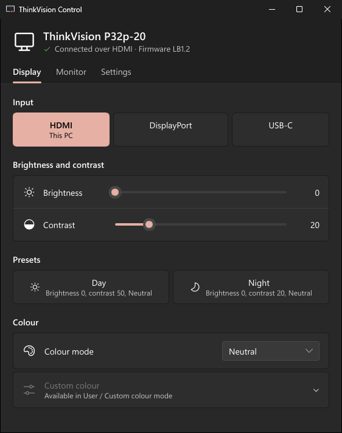
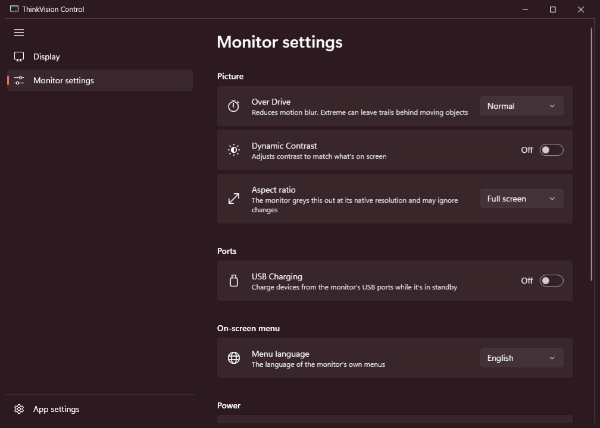
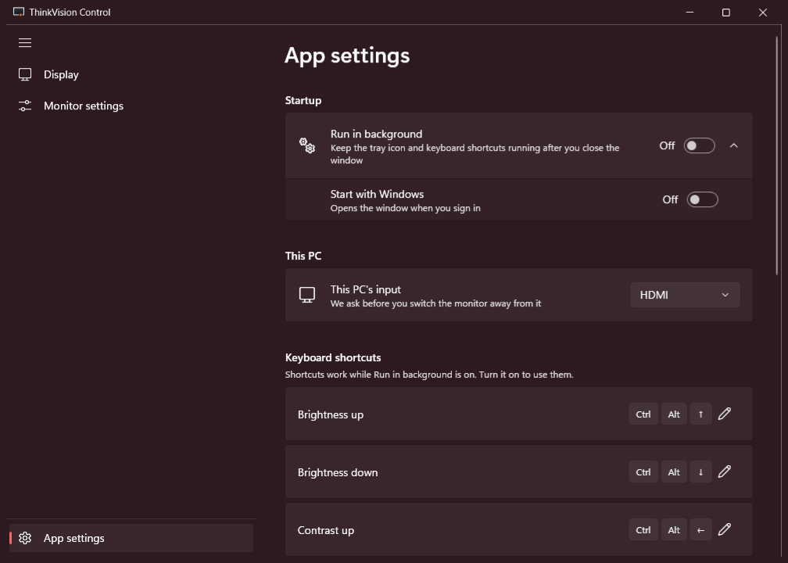
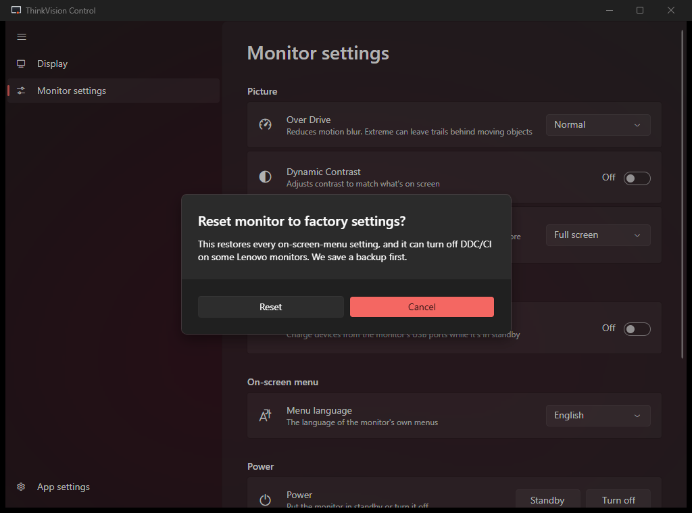
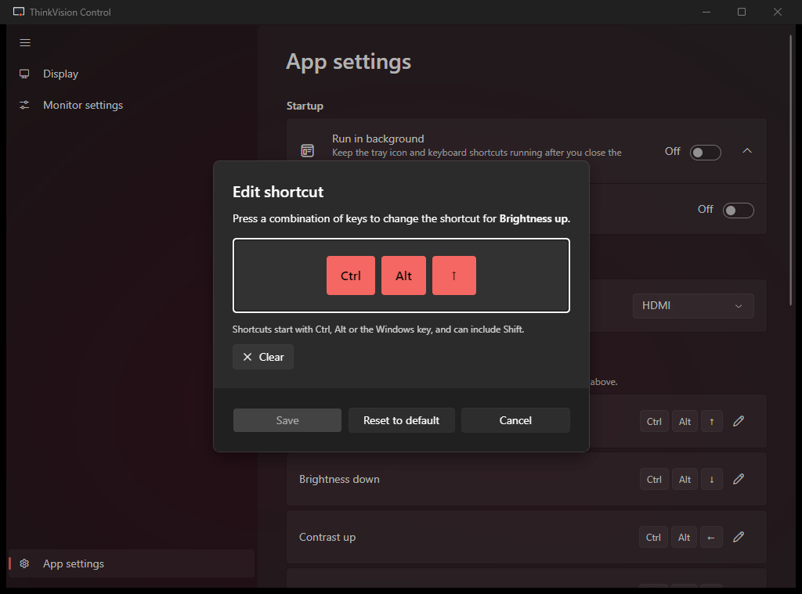
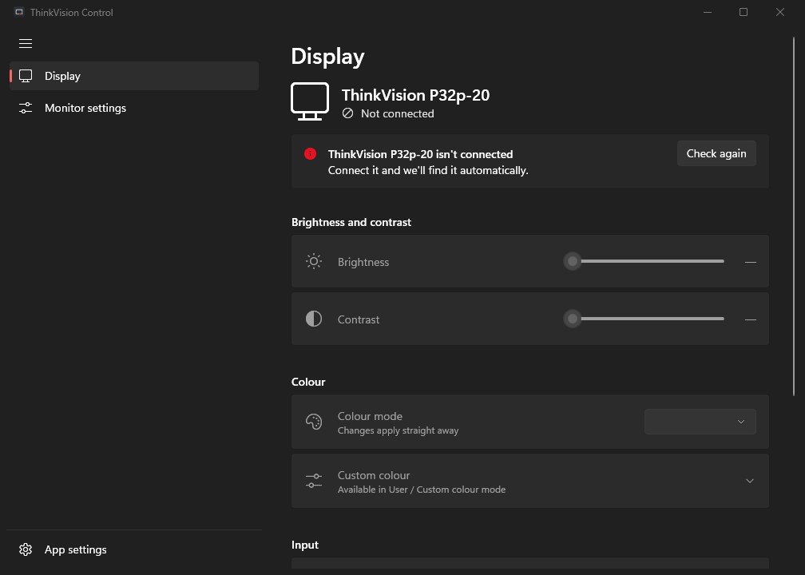
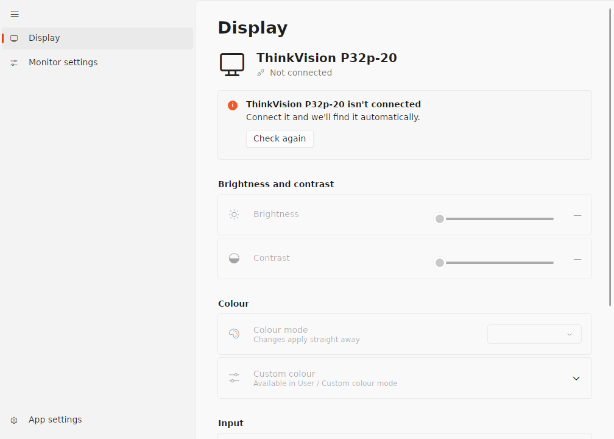
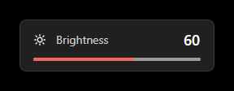

<p align="center">
  
</p>

<h1 align="center">ThinkVision Control</h1>

<p align="center">
  Control your Lenovo ThinkVision P32p-20 from the computer instead of its buttons.<br>
  Brightness, contrast, input, colour modes and the rest of the on-screen menu, over DDC/CI, on Windows, macOS and Linux.
</p>

<p align="center">
  <a href="LICENSE"></a>
  
  
  
  
</p>

<p align="center">
  
</p>

## Why

The P32p-20's menu buttons sit behind the bottom edge of the screen. They're hard to find in the dark, slow to step through, and on many units they wear out. Every setting in that menu travels over the video cable too, through a standard called DDC/CI. ThinkVision Control puts those settings in a proper app with keyboard shortcuts, so you rarely need to touch the monitor.

> This is an unofficial project. It is not affiliated with or endorsed by Lenovo.

## Features

- **Everything in the on-screen menu that DDC/CI exposes:** brightness, contrast, colour mode (sRGB, DCI-P3, BT.709, Neutral, Reddish, Bluish, Low Blue Light, Custom), custom red/green/blue gain, input (HDMI, DisplayPort, USB-C), Over Drive, Dynamic Contrast, USB Charging, aspect ratio, menu language, standby and power off.
- **Live sliders:** the monitor follows as you drag, and the value is checked once you let go. If the monitor keeps an old value (some colour modes lock brightness), the app tells you why.
- **Day and Night presets:** one click or one key sets brightness, contrast and colour mode together. Save your own from the current settings.
- **Global keyboard shortcuts**, with an on-screen level indicator: brightness and contrast up/down, presets, input switching, and "switch the monitor to this computer". You can rebind any of them.
- **Quick access** without opening the window: keyboard shortcuts, the tray menu (the menu-bar menu on macOS) with presets and "Switch to this PC", and taskbar jump-list actions on Windows. Clicking the tray icon opens the app.
- **Two computers, one monitor:** each machine knows its own input, so "Switch to this PC" always brings the screen back to the one you're at.
- **Stays in sync:** while the window is open it re-reads the monitor every few seconds, so changes made with the monitor's buttons or from the other computer show up.
- **Safe by design:**
  - factory reset, reset brightness and contrast, reset colour, and power off all ask first;
  - a backup is saved before any reset, and "Restore backup" undoes it;
  - the app never writes settings it doesn't understand.
- **Hidden settings finder:** watch the monitor's undocumented codes change while you press its buttons, then name them so they appear in the app. This is how Over Drive, Dynamic Contrast and USB Charging were mapped.
- **Native look and theme-aware:** Windows 11 Fluent design with Mica, light and dark mode, and your accent colour. A clear message when the monitor isn't connected, isn't answering, or needs a one-time setup step.
- **Light on resources:** by default the app exits when you close the window. "Run in background" keeps the tray and shortcuts alive, uses about 15 MB of memory on Windows, and doesn't poll while the window is closed.
- **Command line** for scripts, launchers and Stream Deck: `--preset night`, `--input usbc`, `--step brightness=+5`.

## Screenshots

| | |
|---|---|
|  |  |
| **Monitor settings:** Over Drive, Dynamic Contrast, USB Charging, menu language, power and resets | **App settings:** run in background, start with Windows, keyboard shortcuts |
|  |  |
| **Guarded actions** ask first, and back up your settings | **Shortcut editor:** press the keys you want |
|  |  |
| **Not connected:** everything stays visible, with the reason and a fix | **Linux** (Ubuntu), light theme |

<p align="center">
  
</p>
<p align="center">The <b>on-screen indicator</b> shown by shortcuts</p>

## Supported monitors

| Monitor | Status |
|---|---|
| Lenovo ThinkVision **P32p-20** | ✅ Supported, tested daily |

This is currently the only supported model. The app looks for the P32p-20 by its hardware ID and won't connect to other monitors, including other ThinkVision models. Want yours added? See [Contributing](#contributing).

## Platform support

There are two apps that share the same core:

| App | Runs on | Status |
|---|---|---|
| **WPF app** (`src/ThinkVisionControl`) | Windows 10/11 | Stable, tested daily on a P32p-20 |
| **Avalonia app** (`src/ThinkVisionControl.Avalonia`) | macOS (Apple Silicon), Linux, and Windows as a preview | New. It will replace the WPF app on Windows once it matches it on start-up time and memory |

| Feature | Windows | macOS | Linux (X11 / KDE) | Linux (GNOME on Wayland) |
|---|---|---|---|---|
| Monitor control | ✅ | ✅ USB-C, Thunderbolt, DP | ✅ after one-time setup | ✅ after one-time setup |
| Tray / menu bar | ✅ | ✅ menu bar | ✅ | AppIndicator extension needed |
| Global shortcuts | ✅ | ✅ | ✅ | GNOME 48+; otherwise bind desktop shortcuts to commands |
| On-screen indicator | ✅ | ✅ | ✅ on X11; notification on Wayland | notification |
| Start at login | ✅ | ✅ | ✅ | ✅ |

macOS and Linux support is new and has been verified in builds and a Linux VM, but not yet on every desktop. Please [open an issue](../../issues) with what works and what doesn't on yours.

## Before you start

- **Windows:** download `ThinkVisionControl-Setup-<version>.exe` from [Releases](../../releases) and run it. To build from source instead, you need the [.NET 10 SDK](https://dotnet.microsoft.com/download/dotnet/10.0) and `git`.
- **macOS and Linux:** the .NET 10 SDK and `git`; you build from source with the commands below.
- The monitor connected **directly** with USB-C, DisplayPort or HDMI. Docks, KVMs and DisplayLink adapters often block DDC/CI.
- **DDC/CI enabled** on the monitor. It's on by default. Holding the monitor's **Exit** key for 10 seconds toggles it, and the screen shows "DDC/CI enable" or "DDC/CI disable".

## Windows

**Install:** run `ThinkVisionControl-Setup-<version>.exe` (about 3 MB). Setup lets you:

- choose the install folder (default `C:\Program Files\ThinkVision Control`);
- create Start menu and desktop shortcuts;
- install the **.NET 10 Desktop Runtime**, which the app needs. Setup checks for it first. If it's already installed, setup skips it. If it's missing, setup downloads it from Microsoft (about 60 MB). Windows 11 doesn't include it.

If you skip the runtime, the app shows a "You must install or update .NET" message with a download button when you open it.

Uninstall from **Settings → Apps**. Your settings in `%APPDATA%\ThinkVisionControl` are kept.

**Build from source:**

```powershell
winget install Microsoft.DotNet.SDK.10
winget install Git.Git
git clone https://github.com/MrErrorSan/thinkvision-control.git
cd thinkvision-control
```

Run it straight away:

```powershell
dotnet run --project src/ThinkVisionControl
```

Or build the installer (needs [Inno Setup 6.5+](https://jrsoftware.org/isinfo.php): `winget install JRSoftware.InnoSetup`):

```powershell
.\scripts\make-windows-setup.ps1
```

It writes `build\ThinkVisionControl-Setup-<version>.exe`, and the app files themselves are in `build\win-x64`. "Start with Windows" and "Run in background" are in **App settings**.

## macOS (Apple Silicon)

```bash
brew install --cask dotnet-sdk
brew install git
git clone https://github.com/MrErrorSan/thinkvision-control.git
cd thinkvision-control
```

Build the menu-bar app (no Dock icon) and install it:

```bash
./scripts/make-macos-app.sh
ditto "build/ThinkVision Control.app" "/Applications/ThinkVision Control.app"
open "/Applications/ThinkVision Control.app"
```

- The script signs the app ad hoc, which Apple Silicon needs for local builds. `codesign` comes with the Xcode command line tools (`xcode-select --install`).
- An app you build yourself isn't quarantined, so there's no Gatekeeper prompt and no developer account is needed.
- Use **USB-C, Thunderbolt or DisplayPort**. The built-in HDMI port on M1 and base M2 Macs often can't carry DDC/CI.
- To try it without building the bundle: `dotnet run --project src/ThinkVisionControl.Avalonia`.

## Linux (Ubuntu, Fedora and others)

**1. Install the SDK and clone**

```bash
sudo apt install dotnet-sdk-10.0 git      # Ubuntu / Debian
sudo dnf install dotnet-sdk-10.0 git      # Fedora
git clone https://github.com/MrErrorSan/thinkvision-control.git
cd thinkvision-control
```

If your distribution doesn't package .NET 10 yet: `curl -sSL https://dot.net/v1/dotnet-install.sh | bash -s -- --channel 10.0`, then add `~/.dotnet` to your `PATH`.

**2. Allow access to the monitor (once)**

```bash
sudo modprobe i2c-dev
echo i2c-dev | sudo tee /etc/modules-load.d/i2c-dev.conf
sudo cp packaging/linux/60-thinkvision-i2c.rules /etc/udev/rules.d/
sudo udevadm control --reload && sudo udevadm trigger
```

Then log out and back in. Installing `ddcutil` (`sudo apt install ddcutil`) sets up an equivalent rule instead. If something is still missing, **App settings → System setup** tells you exactly what to run.

**3. Install for your user**

```bash
dotnet publish src/ThinkVisionControl.Avalonia -c Release -r linux-x64 --self-contained -o ~/.local/share/thinkvision-control
mkdir -p ~/.local/bin ~/.local/share/applications ~/.local/share/icons/hicolor/scalable/apps
ln -sf ~/.local/share/thinkvision-control/thinkvision-control ~/.local/bin/thinkvision-control
cp packaging/linux/thinkvision-control.desktop ~/.local/share/applications/
cp assets/brand/svg/app-icon.svg ~/.local/share/icons/hicolor/scalable/apps/thinkvision-control.svg
update-desktop-database ~/.local/share/applications
```

The launcher entry includes Day, Night and "Switch monitor to this computer" in its right-click menu.

<details>
<summary><b>Desktop notes: GNOME, KDE, NVIDIA, shortcuts</b></summary>

- **GNOME tray icon:** GNOME needs the AppIndicator extension. Ubuntu ships it. On Fedora:
  ```bash
  sudo dnf install gnome-shell-extension-appindicator
  gnome-extensions enable appindicatorsupport@rgcjonas.gmail.com   # after logging out and back in
  ```
- **KDE Plasma 6:** Plasma's power manager also controls monitor brightness over DDC/CI, so the two fight and changes don't stick. Turn its DDC off:
  ```bash
  systemctl --user edit plasma-powerdevil.service
  ```
  Add the lines below, save, then run `systemctl --user restart plasma-powerdevil.service`. Laptop screen brightness keeps working.
  ```ini
  [Service]
  Environment=POWERDEVIL_NO_DDCUTIL=1
  ```
- **NVIDIA proprietary driver:** some cards need this option and a reboot:
  ```bash
  echo 'options nvidia NVreg_RegistryDwords=RMUseSwI2c=0x01;RMI2cSpeed=100' | sudo tee /etc/modprobe.d/nvidia-i2c.conf
  ```
- **Global shortcuts:** they work on X11 and KDE Plasma (Wayland too; Plasma asks you to confirm once). GNOME 48+ also supports them. On older GNOME on Wayland (for example Ubuntu 24.04), bind desktop shortcuts to commands instead, such as `~/.local/bin/thinkvision-control --step brightness=+5` (Settings → Keyboard → Custom Shortcuts).
- **Default shortcuts:** `Ctrl+Alt+F1`–`F3` switch virtual consoles on Linux, and GNOME uses `Ctrl+Alt+arrows` for workspaces. Pick other keys in **App settings → Keyboard shortcuts**.

</details>

## Command line

The same options work on every OS. If the app is already running, the command goes to it. Otherwise the app performs the action, shows the indicator and exits, without opening a window.

| Option | What it does |
|---|---|
| `--preset day` / `--preset night` | Applies the Day or Night preset |
| `--input hdmi` / `dp` / `usbc` / `this` | Switches the input. `this` means this computer's input, set in App settings |
| `--step brightness=+5` / `--step contrast=-5` | Changes brightness or contrast by a step |
| `--startup` | Starts in the tray or menu bar with no window, as at login |

```bash
thinkvision-control --preset night                                           # Linux
"/Applications/ThinkVision Control.app/Contents/MacOS/thinkvision-control" --input usbc   # macOS
"C:\Program Files\ThinkVision Control\ThinkVisionControl.exe" --step brightness=+10   # Windows
```

## Default shortcuts

| Action | Keys |
|---|---|
| Brightness up / down | `Ctrl+Alt+↑` / `Ctrl+Alt+↓` |
| Contrast up / down | `Ctrl+Alt+←` / `Ctrl+Alt+→` |
| Day / Night preset | `Ctrl+Alt+Home` / `Ctrl+Alt+End` |
| Input HDMI / DisplayPort / USB-C | `Ctrl+Alt+F1` / `F2` / `F3` |
| Switch the monitor to this computer | `Ctrl+Alt+M` |
| Open the app | `Ctrl+Alt+O` |

Shortcuts are active while **Run in background** is on.

## Troubleshooting

- **"Monitor isn't connected":** use a direct cable. Docks, hubs and KVMs often block DDC/CI, and DisplayLink never passes it. On a Mac, prefer USB-C or Thunderbolt over HDMI.
- **"Your monitor isn't responding":** DDC/CI is probably off. Hold the monitor's **Exit** key for 10 seconds until it shows "DDC/CI enable". An accidental long press is the usual cause.
- **Brightness won't change:** the sRGB, DCI-P3 and BT.709 colour modes lock brightness on this monitor. Switch to Neutral or Custom.
- **Linux: permission or module messages:** redo step 2 above and log back in. `ls -l /dev/i2c-*` should list devices.
- **Logs:** `%APPDATA%\ThinkVisionControl\log.txt` on Windows, `~/.config/ThinkVisionControl/log.txt` on macOS and Linux.

## How it works

DDC/CI is a small command channel inside every modern video cable. Each menu setting has a code, called a VCP code (for example `0x10` is brightness and `0x60` is input), and the app reads and writes these codes:

| OS | How the app reaches the monitor |
|---|---|
| Windows | The built-in Monitor Configuration API (`dxva2`) |
| Linux | `/dev/i2c-*` directly, with its own packet encoder and decoder. No ddcutil dependency |
| macOS (Apple Silicon) | The `IOAVService` interface, the same route MonitorControl and m1ddc use |

All commands go through one queue that paces them for the monitor. A read waits 400 ms after a write; this was measured on the P32p-20, where reads fail while a change settles but writes 50 ms apart all apply. A safety policy decides what may be written at all. The P32p-20's capabilities, colour-mode codes and vendor codes are mapped in `src/ThinkVisionControl.Core/Profile/p32p20.profile.json`, so other ThinkVision models can be added there.

<details>
<summary><b>Project layout</b></summary>

| Path | What it is |
|---|---|
| `src/ThinkVisionControl.Core` | Shared logic: control service, safety rules, monitor profile, settings, command line, DDC packet codec. No OS calls |
| `src/ThinkVisionControl.Ddc.Windows` | Windows monitor link (dxva2) |
| `src/ThinkVisionControl.Ddc.Linux` | Linux monitor link (`/dev/i2c-*`) |
| `src/ThinkVisionControl.Ddc.MacOS` | macOS monitor link (IOAVService), plus a first-run probe |
| `src/ThinkVisionControl` | Windows WPF app |
| `src/ThinkVisionControl.Avalonia` | Cross-platform Avalonia app with its Windows, macOS and Linux platform layers |
| `tests/ThinkVisionControl.Tests` | Unit tests: `dotnet test tests/ThinkVisionControl.Tests` |
| `scripts/make-macos-app.sh` | Builds the macOS `.app` bundle |
| `packaging/linux/` | udev rule and launcher entry |
| `assets/brand/` | App icon (SVG, PNG, ICO, ICNS) |

</details>

## Contributing

Bug reports, tests on other desktops and Macs, and support for more ThinkVision models are all welcome. For a new model, the most useful thing to include in an issue is its capabilities string. The app logs it, and the macOS probe in `src/ThinkVisionControl.Ddc.MacOS/probe` prints it.

## Licence

ThinkVision Control is free software, released under the **GNU General Public License, version 2 or (at your option) any later version**. See [LICENSE](LICENSE).

It includes the [Fluent UI System Icons](https://github.com/microsoft/fluentui-system-icons) font, © Microsoft, under the MIT licence (`src/ThinkVisionControl.Avalonia/Assets/Fonts/LICENSE`). It uses [Avalonia](https://avaloniaui.net/) and [FluentAvalonia](https://github.com/amwx/FluentAvalonia), both MIT.

The macOS and Linux monitor code was informed by [MonitorControl](https://github.com/MonitorControl/MonitorControl) and [m1ddc](https://github.com/waydabber/m1ddc), both MIT, and by the [ddcutil](https://www.ddcutil.com/) documentation.

Lenovo and ThinkVision are trademarks of Lenovo. This project is not affiliated with Lenovo.
