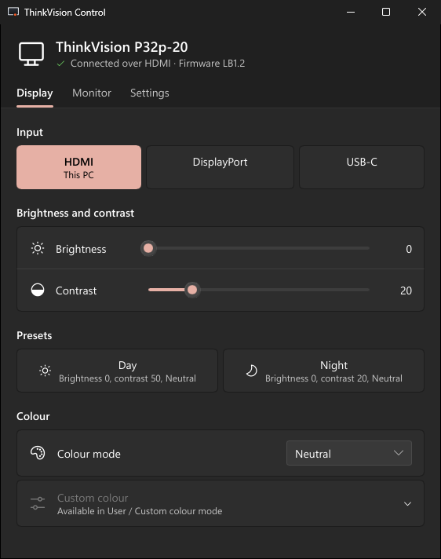
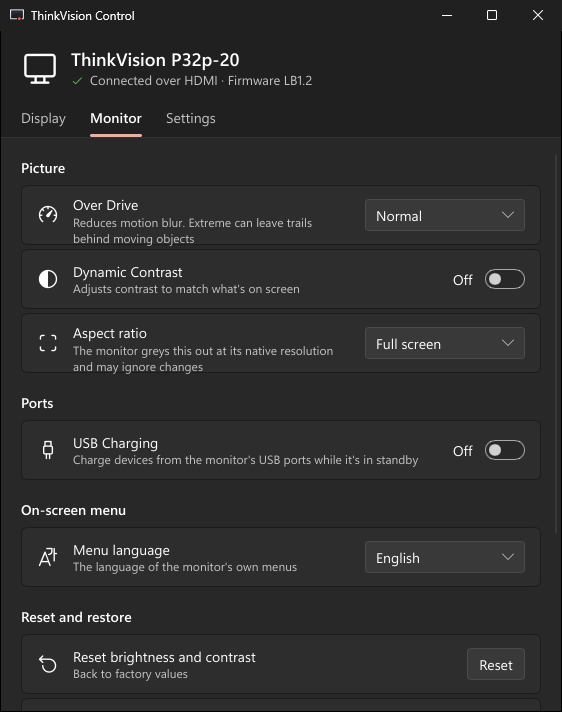
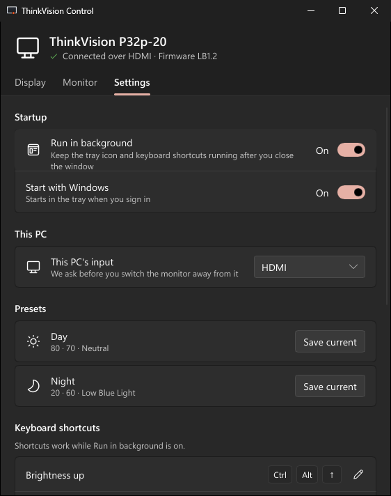
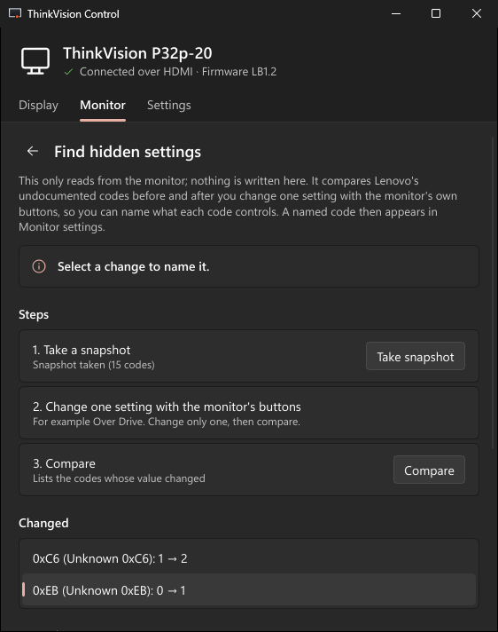
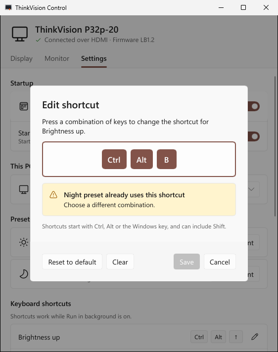
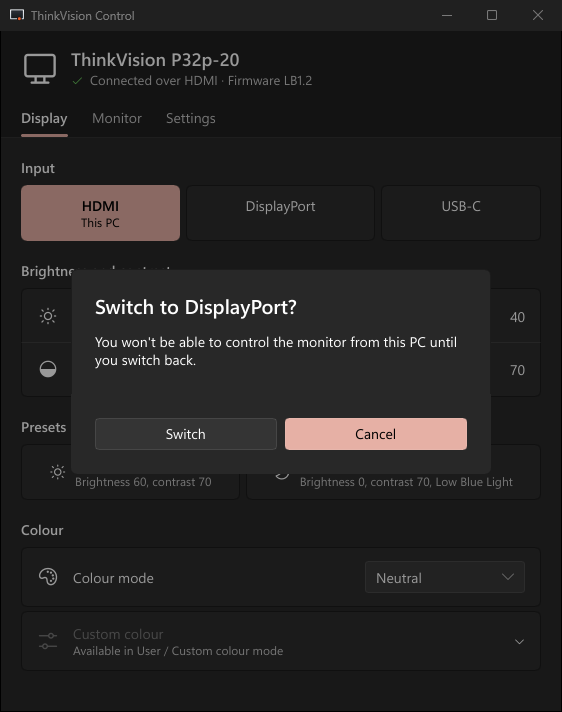
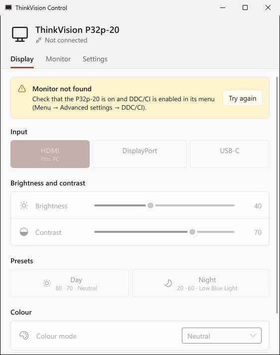

<p align="center">
  
</p>

<h1 align="center">ThinkVision Control</h1>

<p align="center">
  Control your Lenovo ThinkVision P32p-20 from the computer instead of its buttons.<br>
  Brightness, contrast, input, colour modes and the rest of the on-screen menu, over DDC/CI, on Windows, macOS and Linux.
</p>

<p align="center">
  <a href="LICENSE"></a>
  
  
  
  
</p>

<p align="center">
  
</p>

## Why

The P32p-20's menu buttons sit behind the bottom edge of the screen. They're hard to find in the dark, slow to step through, and on many units they wear out. Every setting in that menu travels over the video cable too, through a standard called DDC/CI. ThinkVision Control puts those settings in a proper app with keyboard shortcuts, so you rarely need to touch the monitor.

> This is an unofficial project. It is not affiliated with or endorsed by Lenovo.

## Features

- **Everything in the on-screen menu that DDC/CI exposes:** brightness, contrast, colour mode (sRGB, DCI-P3, BT.709, Neutral, Reddish, Bluish, Low Blue Light, Custom), custom red/green/blue gain, input (HDMI, DisplayPort, USB-C), Over Drive, Dynamic Contrast, USB Charging, aspect ratio and menu language.
- **One compact window** with three tabs. **Display** has what you use every day on one screen: input, brightness and contrast, Day and Night presets, and colour. **Monitor** has the rest of the menu, resets and the hidden settings finder. **Settings** has startup, this PC's input, presets and keyboard shortcuts.
- **Live sliders:** the monitor follows as you drag, and the value is checked once you let go. If the monitor keeps an old value (some colour modes lock brightness), the app tells you why.
- **Day and Night presets:** one click or one key sets brightness, contrast and colour mode together. Save your own from the current settings.
- **Automatic Day/Night** (0.0.5): applies the presets by themselves, at times you set or at sunrise and sunset for a location you type. If the PC was asleep at the switch time, it catches up when it wakes.
- **Global keyboard shortcuts**, with an on-screen level indicator: brightness and contrast up/down, presets, input switching, and "switch the monitor to this computer". You can rebind any of them.
- **Quick access** without opening the window: keyboard shortcuts, and the tray menu (the menu-bar menu on macOS) with presets and "Switch to this PC". Clicking the tray icon opens the app.
- **Two computers, one monitor:** each machine knows its own input, so "Switch to this PC" always brings the screen back to the one you're at.
- **Stays in sync:** while the window is open it re-reads the monitor every few seconds, so changes made with the monitor's buttons or from the other computer show up.
- **Reliability** (0.0.5): the app pauses while the monitor sleeps or the PC is locked, and keeps trying to reconnect for about a minute after a wake. If it crashed while probing the monitor, the next start is in safe mode, with no writes until you leave it.
- **Safe by design:**
  - factory reset, reset brightness and contrast, and reset colour all ask first;
  - a backup is saved before any reset, and "Restore backup" undoes it;
  - the app never writes settings it doesn't understand;
  - it has no power control: it never puts the monitor in standby or turns it off, because monitors sometimes won't wake again without a power cycle.
- **Hidden settings finder:** watch the monitor's undocumented codes change while you press its buttons, then name them so they appear in the app. This is how Over Drive, Dynamic Contrast and USB Charging were mapped.
- **Fluent look and theme-aware:** light and dark mode, and your accent colour. A clear message when the monitor isn't connected, isn't answering, or needs a one-time setup step.
- **Light on resources:** one 9 MB program with no runtime to install. By default the app exits when you close the window. "Run in background" keeps the tray and shortcuts alive; closing the window then frees it, so the app idles at about 3 MB of memory and doesn't poll the monitor.
- **Command line and links** for scripts, launchers and Stream Deck: `--preset night`, `--input usbc`, `--step brightness=+5`, `--get brightness`, and `thinkvision://` links.

## Screenshots

| | |
|---|---|
|  |  |
| **Monitor tab:** Over Drive, Dynamic Contrast, aspect ratio, USB Charging, menu language, resets | **Settings tab:** run in background, start with Windows, this PC's input, presets, keyboard shortcuts |
|  |  |
| **Hidden settings finder:** snapshot, change one setting on the monitor, compare | **Shortcut editor:** press the keys you want; clashes are caught |
|  |  |
| **Asks first** before switching the monitor away from this PC | **Not connected:** everything stays visible, with the reason and a fix |

## Supported monitors

| Monitor | Status |
|---|---|
| Lenovo ThinkVision **P32p-20** | ✅ Supported, tested daily |

This is currently the only supported model. The app looks for the P32p-20 by its hardware ID and won't connect to other monitors, including other ThinkVision models. Want yours added? See [Contributing](#contributing).

## Platform support

One program, built from the same Rust code for each OS. Windows is the main platform. The Linux and macOS builds share all of the monitor logic, but haven't been tested with the monitor on real hardware yet.

| Feature | Windows | macOS | Linux (X11) | Linux (Wayland: GNOME, KDE) |
|---|---|---|---|---|
| Monitor control | ✅ | ✅ USB-C, Thunderbolt, DP | ✅ after one-time setup | ✅ after one-time setup |
| Tray / menu bar | ✅ | ✅ menu bar | ✅ | ✅ (GNOME: AppIndicator extension needed) |
| Global shortcuts | ✅ | ✅ | ✅ | Not yet: bind desktop shortcuts to commands |
| On-screen indicator | ✅ | ✅ | ✅ | Notification style not yet ported |
| Start at login | ✅ | ✅ | ✅ | ✅ |

Please [open an issue](../../issues) with what works and what doesn't on your desktop or Mac.

## Before you start

- **Windows:** download `ThinkVisionControl-Setup-<version>.exe` from [Releases](../../releases) and run it.
- **Linux:** download `thinkvision-control-<version>-linux-x64.tar.gz` from [Releases](../../releases).
- **macOS, or to build from source:** [Rust](https://rustup.rs) (stable) and `git`; you build with the commands below.
- The monitor connected **directly** with USB-C, DisplayPort or HDMI. Docks, KVMs and DisplayLink adapters often block DDC/CI.
- **DDC/CI enabled** on the monitor. It's on by default. Holding the monitor's **Exit** key for 10 seconds toggles it, and the screen shows "DDC/CI enable" or "DDC/CI disable".

## Windows

**Install:** run `ThinkVisionControl-Setup-<version>.exe`. The app is a single program with nothing else to download. Setup lets you:

- choose the install folder (default `C:\Program Files\ThinkVision Control`);
- create Start menu and desktop shortcuts.

Installing over 0.0.4 or earlier keeps your settings and removes the old .NET app files. The .NET 10 Desktop Runtime that 0.0.4 needed isn't used any more; you can uninstall it from **Settings → Apps** if nothing else needs it.

Uninstall from **Settings → Apps**. Your settings in `%APPDATA%\ThinkVisionControl` are kept.

**Build from source:**

```powershell
winget install Rustlang.Rustup
winget install Git.Git
git clone https://github.com/MrErrorSan/thinkvision-control.git
cd thinkvision-control
```

Rust on Windows also needs the Visual Studio C++ build tools; rustup offers to install them.

Run it straight away:

```powershell
cargo run --release -p tvc-app
```

Or build the installer (needs [Inno Setup 6.5+](https://jrsoftware.org/isinfo.php): `winget install JRSoftware.InnoSetup`):

```powershell
.\scripts\make-windows-setup.ps1
```

It writes `build\ThinkVisionControl-Setup-<version>.exe`; the program itself is `target\release\thinkvision-control.exe`. "Start with Windows" and "Run in background" are in the **Settings** tab.

## macOS (Apple Silicon)

```bash
curl --proto '=https' --tlsv1.2 -sSf https://sh.rustup.rs | sh
rustup target add aarch64-apple-darwin
brew install git
git clone https://github.com/MrErrorSan/thinkvision-control.git
cd thinkvision-control
```

Build the menu-bar app (no Dock icon) and install it:

```bash
./scripts/make-macos-app.sh
ditto "build/ThinkVision Control.app" "/Applications/ThinkVision Control.app"
open "/Applications/ThinkVision Control.app"
```

- The script signs the app ad hoc, which Apple Silicon needs for local builds. `codesign` comes with the Xcode command line tools (`xcode-select --install`).
- An app you build yourself isn't quarantined, so there's no Gatekeeper prompt and no developer account is needed.
- Use **USB-C, Thunderbolt or DisplayPort**. The built-in HDMI port on M1 and base M2 Macs often can't carry DDC/CI.
- To try it without building the bundle: `cargo run --release -p tvc-app`.

## Linux (Ubuntu, Fedora and others)

**1. Install for your user**

```bash
tar xzf thinkvision-control-<version>-linux-x64.tar.gz
./thinkvision-control-<version>-linux-x64/install.sh
```

`install.sh` needs no root. It puts the program in `~/.local/share/thinkvision-control`, links it from `~/.local/bin`, adds the launcher entry and icon, and registers `thinkvision://` links. Run it again to update. The launcher entry includes Day, Night and "Switch monitor to this computer" in its right-click menu.

To build the tarball yourself, install [Rust](https://rustup.rs) and `git`, clone the repository and run `./scripts/make-linux-tarball.sh`. It writes `build/thinkvision-control-<version>-linux-x64.tar.gz`. If the build stops on a missing system library, install its development package.

**2. Allow access to the monitor (once)**

`install.sh` prints these commands at the end:

```bash
sudo modprobe i2c-dev
echo i2c-dev | sudo tee /etc/modules-load.d/i2c-dev.conf
sudo cp 60-thinkvision-i2c.rules /etc/udev/rules.d/
sudo udevadm control --reload && sudo udevadm trigger
```

Run them from the unpacked folder (the rule is also in `packaging/linux/` in the repository), then log out and back in. Installing `ddcutil` (`sudo apt install ddcutil`) sets up an equivalent rule instead. If something is still missing, the **Settings** tab tells you exactly what to run, with a Copy button.

<details>
<summary><b>Desktop notes: GNOME, KDE, NVIDIA, shortcuts</b></summary>

- **GNOME tray icon:** GNOME needs the AppIndicator extension. Ubuntu ships it. On Fedora:
  ```bash
  sudo dnf install gnome-shell-extension-appindicator
  gnome-extensions enable appindicatorsupport@rgcjonas.gmail.com   # after logging out and back in
  ```
- **KDE Plasma 6:** Plasma's power manager also controls monitor brightness over DDC/CI, so the two fight and changes don't stick. Turn its DDC off:
  ```bash
  systemctl --user edit plasma-powerdevil.service
  ```
  Add the lines below, save, then run `systemctl --user restart plasma-powerdevil.service`. Laptop screen brightness keeps working.
  ```ini
  [Service]
  Environment=POWERDEVIL_NO_DDCUTIL=1
  ```
- **NVIDIA proprietary driver:** some cards need this option and a reboot:
  ```bash
  echo 'options nvidia NVreg_RegistryDwords=RMUseSwI2c=0x01;RMI2cSpeed=100' | sudo tee /etc/modprobe.d/nvidia-i2c.conf
  ```
- **Global shortcuts:** they work on X11. On Wayland (GNOME and KDE) this version doesn't register them yet, and the **Settings** tab says so. Bind desktop shortcuts to commands instead, such as `~/.local/bin/thinkvision-control --step brightness=+5` (GNOME: Settings → Keyboard → Custom Shortcuts; KDE: System Settings → Shortcuts).
- **Default shortcuts:** `Ctrl+Alt+F1`–`F3` switch virtual consoles on Linux, and GNOME uses `Ctrl+Alt+arrows` for workspaces. Pick other keys in **Settings → Keyboard shortcuts**.

</details>

## Command line

The same options work on every OS. If the app is already running, the command goes to it and exits with 0 once handed over; the result shows on the indicator there. Otherwise the app performs the action, shows the indicator and exits, without opening a window.

| Option | What it does |
|---|---|
| `--preset day` / `--preset night` | Applies the Day or Night preset |
| `--input hdmi` / `dp` / `usbc` / `this` | Switches the input. `this` means this computer's input, set in the Settings tab |
| `--step brightness=+5` / `--step contrast=-5` | Changes brightness or contrast by a step |
| `--get brightness` / `contrast` / `input` / `colour-mode` / `all` | Prints the current value (0.0.5) |
| `--json` | With `--get`, prints JSON instead of text |
| `--startup` | Starts in the tray or menu bar with no window, as at login |
| `--help` | Lists the options and exit codes |

```bash
thinkvision-control --preset night                                           # Linux
"/Applications/ThinkVision Control.app/Contents/MacOS/thinkvision-control" --input usbc   # macOS
"C:\Program Files\ThinkVision Control\thinkvision-control.exe" --step brightness=+10   # Windows
thinkvision-control --get all --json
```

`--get all` prints one `name: value` line per setting (`brightness: 40`, `contrast: 70`, `input: HDMI`, `colourMode: Neutral`); with `--json` it prints them as one object, `{"brightness":40,"contrast":70,"input":"HDMI","colourMode":"Neutral"}`. Other commands print their result (`Brightness 45`), or with `--json` an object with `ok`, `kind` and `message`.

`--get` always makes its own read-only connection, even while the app is running, because a command handed over to the running app can't send output back.

**Exit codes** (0.0.5), for scripts:

| Code | Meaning |
|---|---|
| 0 | Done |
| 1 | Monitor not found |
| 2 | Value out of range |
| 4 | The monitor doesn't support it |
| 5 | The monitor isn't responding (DDC/CI off?) |
| 8 | Timed out |

**Links** (0.0.5): the installer, `install.sh` and the macOS app register `thinkvision://`, so a link does the same as a command from a browser, launcher, Run box (Win+R) or Stream Deck:

| Link | Same as |
|---|---|
| `thinkvision://open` | Opening the app |
| `thinkvision://preset/day` / `preset/night` | `--preset day` / `night` |
| `thinkvision://input/hdmi` / `dp` / `usbc` / `this` | `--input ...` |
| `thinkvision://step/brightness/+5` | `--step brightness=+5` |
| `thinkvision://get/brightness` | `--get brightness` |

## Default shortcuts

| Action | Keys |
|---|---|
| Brightness up / down | `Ctrl+Alt+↑` / `Ctrl+Alt+↓` |
| Contrast up / down | `Ctrl+Alt+←` / `Ctrl+Alt+→` |
| Day / Night preset | `Ctrl+Alt+Home` / `Ctrl+Alt+End` |
| Input HDMI / DisplayPort / USB-C | `Ctrl+Alt+F1` / `F2` / `F3` |
| Switch the monitor to this computer | `Ctrl+Alt+M` |
| Open the app | `Ctrl+Alt+O` |

Shortcuts are active while **Run in background** is on.

## Troubleshooting

- **"Monitor isn't connected":** use a direct cable. Docks, hubs and KVMs often block DDC/CI, and DisplayLink never passes it. On a Mac, prefer USB-C or Thunderbolt over HDMI.
- **"Your monitor isn't responding":** DDC/CI is probably off. Hold the monitor's **Exit** key for 10 seconds until it shows "DDC/CI enable". An accidental long press is the usual cause.
- **Brightness won't change:** the sRGB, DCI-P3 and BT.709 colour modes lock brightness on this monitor. Switch to Neutral or Custom.
- **Linux: permission or module messages:** redo step 2 above and log back in. `ls -l /dev/i2c-*` should list devices.
- **Logs:** `%APPDATA%\ThinkVisionControl\log.txt` on Windows, `~/.config/ThinkVisionControl/log.txt` on macOS and Linux.

## How it works

DDC/CI is a small command channel inside every modern video cable. Each menu setting has a code, called a VCP code (for example `0x10` is brightness and `0x60` is input), and the app reads and writes these codes:

| OS | How the app reaches the monitor |
|---|---|
| Windows | The built-in Monitor Configuration API (`dxva2`) |
| Linux | `/dev/i2c-*` directly, with its own packet encoder and decoder. No ddcutil dependency |
| macOS (Apple Silicon) | The `IOAVService` interface, the same route MonitorControl and m1ddc use |

All commands go through one worker thread that paces them for the monitor. A read waits 400 ms after a write; this was measured on the P32p-20, where reads fail while a change settles but writes 50 ms apart all apply. A safety policy decides what may be written at all; power (`0xD6`) and the OSD lock (`0xCA`) are never written from any path. The P32p-20's capabilities, colour-mode codes and vendor codes are mapped in `crates/tvc-core/src/profile/p32p20.json`, so other ThinkVision models can be added there.

<details>
<summary><b>Project layout</b></summary>

| Path | What it is |
|---|---|
| `crates/tvc-core` | Shared logic: monitor engine, safety rules, monitor profile, settings, command line, DDC packet codec, finder. No OS calls. Tests: `cargo test --workspace` |
| `crates/tvc-ddc` | Monitor links for Windows (dxva2), Linux (`/dev/i2c-*`) and macOS (IOAVService), plus a read-only probe: `cargo run -p tvc-ddc --example probe` |
| `crates/tvc-app` | The `thinkvision-control` program: Slint UI (`ui/`), tray, shortcuts, on-screen indicator, OS integration. `--demo` runs it against a simulated monitor |
| `scripts/make-windows-setup.ps1` | Builds the Windows installer |
| `scripts/make-linux-tarball.sh` | Builds the Linux tarball with its `install.sh` |
| `scripts/make-macos-app.sh` | Builds the macOS `.app` bundle |
| `scripts/subset-icon-font.py` | Cuts the icon font down to the glyphs the UI uses. Run it after adding an icon (`pip install fonttools`, then `python -I scripts/subset-icon-font.py`) |
| `packaging/` | Windows installer script, Linux udev rule and launcher entry |
| `assets/brand/` | App icon (SVG, PNG, ICO, ICNS) |

</details>

## Contributing

Bug reports, tests on other desktops and Macs, and support for more ThinkVision models are all welcome. For a new model, the most useful thing to include in an issue is its capabilities string. The app logs it, and `cargo run -p tvc-ddc --example probe` prints it without writing anything to the monitor.

## Licence

ThinkVision Control is free software, released under the **GNU General Public License, version 2 or (at your option) any later version**. See [LICENSE](LICENSE).

It is built with [Slint](https://slint.dev/), used under Slint's GPLv3 licence option, which the "or later" clause allows; the program as distributed, with Slint inside, is therefore covered by GPLv3. It includes the [Fluent UI System Icons](https://github.com/microsoft/fluentui-system-icons) font, © Microsoft, under the MIT licence (`crates/tvc-app/ui/fonts/LICENSE-FluentSystemIcons.txt`). It uses the [global-hotkey](https://github.com/tauri-apps/global-hotkey) crate (MIT or Apache-2.0).

The macOS and Linux monitor code was informed by [MonitorControl](https://github.com/MonitorControl/MonitorControl) and [m1ddc](https://github.com/waydabber/m1ddc), both MIT, and by the [ddcutil](https://www.ddcutil.com/) documentation.

Lenovo and ThinkVision are trademarks of Lenovo. This project is not affiliated with Lenovo.
