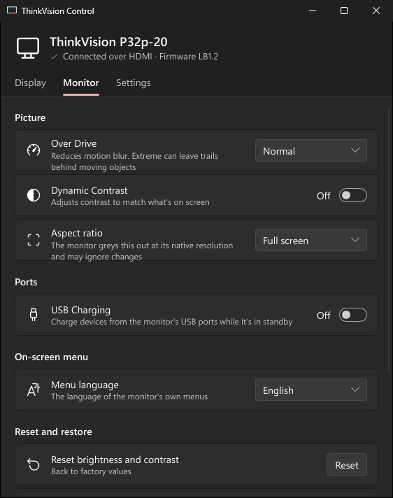
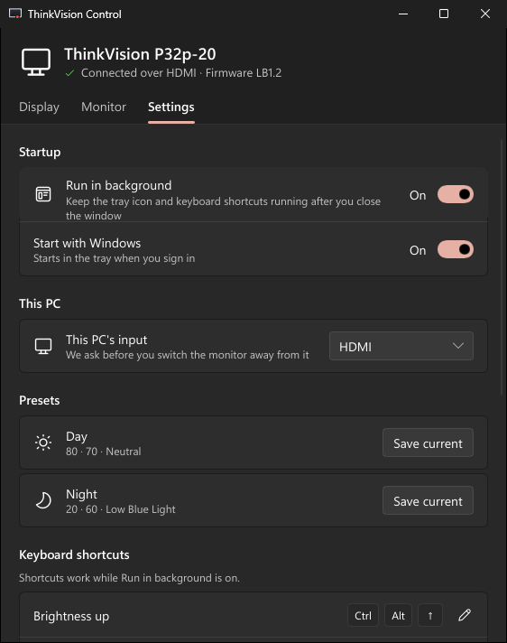

<p align="center">
  
</p>

<h1 align="center">ThinkVision Control</h1>

<p align="center">
  Control your Lenovo ThinkVision P32p-20 from the computer instead of its buttons:<br>
  brightness, contrast, input, colour modes and the rest of the on-screen menu, over DDC/CI.
</p>

<p align="center">
  <a href="LICENSE"></a>
  
  
  
  <a href="https://slint.dev">
    <picture>
      <source media="(prefers-color-scheme: dark)" srcset="https://raw.githubusercontent.com/slint-ui/slint/master/logo/MadeWithSlint-logo-dark.svg">
      
    </picture>
  </a>
</p>

<p align="center">
  
</p>

> Unofficial project, not affiliated with or endorsed by Lenovo.

## What it does

- **The whole on-screen menu in one small window:** input, brightness and contrast, Day/Night presets and colour on the first tab; Over Drive, Dynamic Contrast, aspect ratio, USB charging, menu language and resets on the second.
- **Keyboard shortcuts** with an on-screen indicator, and a **tray menu**, so you rarely open the window.
- **Two PCs, one monitor:** "Switch to this PC" always brings the screen back to the computer you're at.
- **Automatic Day/Night** at set times, or at sunrise and sunset for a place you type.
- **Careful with your monitor:** resets ask first and save a backup; it never turns the monitor off and never writes settings it doesn't understand; it waits while the monitor sleeps or the PC is locked.
- **Small:** one 9 MB program, no runtime; about 3 MB of memory in the tray.

| | |
|---|---|
|  |  |

## Install

Download from [Releases](../../releases).

**Windows 10/11:** run `ThinkVisionControl-Setup-<version>.exe`. If SmartScreen warns (the setup isn't code-signed yet), choose **More info → Run anyway**.

**Linux (x64, preview):** download `thinkvision-control-<version>-linux-x64.tar.gz`, then:

```bash
tar xzf thinkvision-control-*-linux-x64.tar.gz && ./thinkvision-control-*-linux-x64/install.sh
```

It installs for your user and offers to set up access to the monitor (asks for your password once). Log out and back in, then start **ThinkVision Control** from your app launcher.

**macOS (Apple Silicon):** there's no download yet. Build and install it with:

```bash
curl --proto '=https' --tlsv1.2 -sSf https://sh.rustup.rs | sh   # Rust, if you don't have it
git clone https://github.com/MrErrorSan/thinkvision-control.git && cd thinkvision-control
./scripts/make-macos-app.sh
```

The script installs the app in Applications and starts it in the menu bar. Linux and macOS haven't been tested with the monitor on real hardware yet; [reports](../../issues) are welcome.

**Before you start:** connect the monitor directly (docks, KVMs and DisplayLink usually block DDC/CI), and keep DDC/CI on (it's on by default; holding the monitor's **Exit** key for 10 s toggles it).

## Shortcuts

Active while **Settings → Run in background** is on; change them in **Settings → Keyboard shortcuts**.

| Action | Keys |
|---|---|
| Brightness up / down | `Ctrl+Alt+↑` / `Ctrl+Alt+↓` |
| Contrast up / down | `Ctrl+Alt+←` / `Ctrl+Alt+→` |
| Day / Night preset | `Ctrl+Alt+Home` / `Ctrl+Alt+End` |
| Input HDMI / DisplayPort / USB-C | `Ctrl+Alt+F1` / `F2` / `F3` |
| Switch the monitor to this PC | `Ctrl+Alt+M` |
| Open the app | `Ctrl+Alt+O` |

## Command line and links

For scripts, launchers and Stream Deck. If the app is running, the command is handed to it.

```bash
thinkvision-control --preset night          # or day
thinkvision-control --input this            # hdmi, dp, usbc, this
thinkvision-control --step brightness=+10   # or contrast=-5
thinkvision-control --get all --json        # brightness, contrast, input, colour-mode, all
thinkvision-control --help                  # everything, including exit codes
```

The same as links: `thinkvision://preset/night`, `thinkvision://input/this`, `thinkvision://step/brightness/+10`.

## Troubleshooting

- **"Isn't connected":** use a direct cable; on a Mac, USB-C or Thunderbolt rather than HDMI.
- **"Isn't responding":** DDC/CI is probably off. Hold the monitor's **Exit** key for 10 s until it shows "DDC/CI enable".
- **Brightness won't change:** the sRGB, DCI-P3 and BT.709 colour modes lock it. Switch to Neutral or Custom.
- **Linux:** if something is still missing, the **Settings** tab shows exactly what to run, with a Copy button.
- **Logs:** `%APPDATA%\ThinkVisionControl\log.txt` (Windows), `~/.config/ThinkVisionControl/log.txt` (Linux, macOS).

## Build from source

With [Rust](https://rustup.rs): `cargo run --release -p tvc-app`. Installers: `scripts/make-windows-setup.ps1` (needs [Inno Setup](https://jrsoftware.org/isinfo.php)), `scripts/make-linux-tarball.sh`, `scripts/make-macos-app.sh`. Tests: `cargo test --workspace`.

Only the P32p-20 is supported today. For another model, open an issue with its capabilities string: `cargo run -p tvc-ddc --example probe` prints it without changing anything on the monitor.

## Licence

GPL-2.0-or-later; see [LICENSE](LICENSE). Built with [Slint](https://slint.dev/) under its GPLv3 option, so the distributed program is GPLv3. Includes the [Fluent UI System Icons](https://github.com/microsoft/fluentui-system-icons) font (© Microsoft, MIT) and uses [global-hotkey](https://github.com/tauri-apps/global-hotkey) (MIT/Apache-2.0). The Linux and macOS monitor code was informed by [MonitorControl](https://github.com/MonitorControl/MonitorControl), [m1ddc](https://github.com/waydabber/m1ddc) and [ddcutil](https://www.ddcutil.com/).

Lenovo and ThinkVision are trademarks of Lenovo.
