# ThinkVision Control 0.1.0

**Tier 2.** The release adds a new architectural boundary (a hub over several engines), cross-crate contracts, and a settings and data migration.
**One release.** Every issue in [the verified register](2026-11-14-issues.md) ships fixed in 0.1.0; nothing is released in between.
**Branch:** `release/0.1.0` (renamed from `feat/device-sourced-status`). The waves are commits on that branch, not releases.

Inputs:
- [Verified issue register](2026-11-14-issues.md). Every task below names the register IDs it closes.
- [Mockups](../mockups/index.html), local HTML.
- First-pass audits: [core/ddc](2026-11-14-audit-core-ddc.md) and [app](2026-11-14-audit-app.md). Their line numbers are wrong in 9 files; use [verification/](verification/) instead.

## Goal

- **Every register issue is fixed,** with a test where the anvil test table requires one.
- **Every display shows the name it reports** (EDID or DDC model) or the name the OS gives it. No user-visible text names a model the code assumed.
- **Two or more displays** can be controlled one at a time or all together. Together mode uses linked sliders with per-display offsets.
- **Monitors without a verified profile work at an Experimental level,** above a hard safety floor no profile can lift. A laptop panel gets brightness.
- **0.0.8 settings and data carry over without user action.**
- **The CLI is scriptable:** errors exit non-zero with a message, and nothing hangs or opens a window by accident.

## Delivery order

```mermaid
flowchart LR
  W0[w0-scaffold] --> W1
  subgraph W1[Wave 1 · fixes · 10 parallel]
    p[parser] & s[safety] & e[engine] & st[store] & c[cli] & d[ddc] & a[app] & u[ui] & pl[platform] & pk[packaging]
  end
  W1 --> W2[w2-contracts]
  W2 --> W3
  subgraph W3[Wave 3 · core + backends · 6 parallel]
    h[hub] & su[support] & wi[win] & li[linux] & ma[macos] & bl[backlight]
  end
  W3 --> W4c[w4-contract]
  W4c --> W4
  subgraph W4[Wave 4 · app · 4 parallel]
    co[controller] & ui[ui] & to[tray-osd] & cl[cli]
  end
  W4 --> W5[w5-verify] --> R[w5-release]
```



Every wave ends with the orchestrator reconciling the agents' work, pushing, and getting CI green on all three OSes before the next wave starts. Wave 1 is fixes only, and doesn't depend on the multi-display design.

## Write sets

A task may edit only the files it is listed against here. Within a wave no two tasks share a file, and Cargo.lock belongs to the one task that adds a crate.

| Task | Files it owns |
| --- | --- |
| w0-scaffold | core `cli.rs`, `safety.rs`, `crash.rs`, `lib.rs`, `tests/mod.rs`; engine.rs, main.rs and controller.rs call sites (signature-only edits); new empty `tests/parser_tests.rs` and `tests/safety_floor_tests.rs` |
| w1-parser | core `mccs.rs`, `tests/profile_tests.rs` (parser tests live here), `tests/parser_tests.rs` |
| w1-safety | core `safety.rs`, `tests/misc_tests.rs`, `tests/safety_floor_tests.rs` |
| w1-engine | core `engine.rs`, `crash.rs`, `fake.rs`, `tests/engine_tests.rs`, `tests/crash_tests.rs`, `tests/mod.rs` (Harness only) |
| w1-store | core `store.rs`, `profile.rs`, `clock.rs`, `tests/settings_tests.rs` |
| w1-cli | core `cli.rs`, `hotkey.rs`, `tests/cli_tests.rs` |
| w1-ddc | everything under `crates/tvc-ddc/` |
| w1-app | app `controller.rs`, `main.rs`, `platform/console.rs`, `localtime.rs`, `clipboard.rs` |
| w1-ui | app `view.rs`, `ui/*.slint` |
| w1-platform | app `platform/*` except `console.rs` |
| w1-packaging | `scripts/`, `packaging/`, `.github/workflows/`, `README.md`, licence files, new `crates/tvc-launch/`, `Cargo.lock` |
| w2-contracts | core new `identity.rs`, new `hub.rs` (types), new `support.rs` (signatures), `link.rs`, `lib.rs`, `fake.rs`; ddc `lib.rs`, `edid.rs`, `Cargo.toml` (all windows-sys features for Wave 3) |
| w3-hub | core `hub.rs`, `engine.rs`, `log.rs`, `tests/mod.rs`, `tests/engine_tests.rs`, new `tests/hub_tests.rs`; app `controller.rs`, `main.rs` (**mechanical compile fixes only**) |
| w3-support | core `support.rs`, `profile.rs`, `profile/*.json`, new `profile/generic-mccs.json`, `store.rs`, `tests/profile_tests.rs`, `tests/settings_tests.rs`, new `tests/support_tests.rs` |
| w3-win | ddc `dxva2.rs` |
| w3-linux | ddc `linux/*` |
| w3-macos | ddc `macos/*` |
| w3-backlight | ddc new `backlight/` |
| w4-contract | app `ui/types.slint`, `ui/app.slint`, a stub in `view.rs`; core `cli.rs` (types only) |
| w4-controller | app `controller.rs`, `main.rs`, `platform/hotkeys.rs` |
| w4-ui | app `view.rs`, `ui/*.slint` except `types.slint`, `app.slint` and `background.slint` |
| w4-tray-osd | app `tray.rs`, `osd.rs`, `ui/background.slint` |
| w4-cli | core `cli.rs`, `hotkey.rs`, `tests/cli_tests.rs` |

## Wave 0: pinned signatures

Each signature lands as a stub that preserves today's behaviour, so every Wave 1 agent compiles against the final shape:

- **`cli::parse(args) -> Result<Parsed, CliError>`**
  - `CliError { message: String }` maps to exit code 2.
  - `Parsed` gains `yes: bool` and `version: bool`.
  - The stub wraps today's parser in `Ok`.
- **`safety::evaluate(.., level: SupportLevel, confirmed: bool)`**, with `pub enum SupportLevel { Verified { profile: String }, LenovoFamily, GenericMccs, ReadOnly }` in a new `support.rs`. Every existing call site passes `SupportLevel::Verified { profile: "p32p20".into() }`.
- **`crash::Marker::new(dir, key: &str)`**. The key is `"pid-<pid>"` in Wave 1 and becomes the `MonitorId` in Wave 3. `left_over(dir)` returns every stale marker whose PID is no longer alive.
- **Test modules:** register `parser_tests` and `safety_floor_tests` in `tests/mod.rs` now, so no Wave 1 agent edits the `mod` list.

## Wave 1: one paragraph of intent per task

**w1-parser** (CORE-01..04, APP-19). Start with a failing test built from the real P40w-20 string (in [verify_tests.rs](verification/verify_tests.rs)).
- Tokenise into `VcpEntry { code, values: Option<Vec<ValueEntry { value, sub: Option<Vec<u8>> }>> }`.
- `Capabilities` keeps today's top-level values for `allows_value`, plus per-code flags `nested` and `duplicate`.
- Duplicates merge as a union for display. Writes are allowed only for values present in every occurrence. FF is never offered as an input.
- A broken section, or a broken entry inside `vcp`, is skipped and recorded in `Capabilities::warnings`. Only "no vcp section" stays fatal.
- `model` errors give an empty model. Find `vcp (` with spaces, and read every `vcp(` section.
- Error positions count from the start of the whole string.
- Parse `vcpname(...)` into `names: BTreeMap<u8, String>`, plus `mccs_ver` and `cmds`.
- Add the MCCS 0x60 input-name table, from MCCS 2.2a, for monitors with no profile.
- `firmware()` applies only when the profile says the monitor uses the ASCII-0x04 convention.

**w1-safety** (CORE-08 and CORE-09, core part).
- `evaluate` refuses D6 and CA always.
- It refuses 04, and any E0–FF code unnamed by the profile or by `vcpname`, unless the level is `Verified`. So the P32p-20 factory reset keeps working.
- 0x60 returns `Verdict::NeedsConfirmation` unless `confirmed`.
- At `ReadOnly`, every write is refused.
- Pin each rule with a test in `safety_floor_tests.rs`, including "a profile marking D6 writable is still refused".

**w1-engine** (CORE-05, 06 read side, 07, 08, 10, 11, 12, 13, 14, 18, 19, DDC-03).
- **Restore** excludes 0x60, 0xCC and every action code. It writes in `apply_preset` order (colour mode first) and continues past "Kept", reporting a combined result.
- **Capabilities cache:** a `cached_raw` that doesn't parse is discarded and read live again, even in safe mode, because it's a read and not a risky write.
- **Synthesised capabilities** are used for display only. `evaluate` receives the live or cached capabilities, and writes wait until one of those exists.
- **0x60** is written exactly once, at the engine layer, with no `Transient` retry of a Set for 0x60 or action codes. A Step on 0x60 goes through the same confirmation as a Set.
- **Drags:** a drag expires 2 s after its last DragTo and is cleared on any status change. Coalescing stops at an intervening Set or Step for the same code.
- **All codes Unsupported** after connect gives `NotResponding`, with the message "answers but supports none of the controls this app uses".
- **Shutdown** waits up to 2 s, and `run_op` checks `stop` between its sleeps.
- **The lock note** comes from the profile only; the hard-coded engine copy is removed.
- **Crash markers** use the per-key API from Wave 0.
- **`EngineHandle::send` failure** is logged once and surfaces as `Status{NotResponding}`.

**w1-store** (CORE-06 write side, 15, 16, 17, 20).
- Every store write goes to `*.tmp` and is then renamed into place.
- Settings loading:
  - A UTF-8 BOM is stripped.
  - A missing `Day` or `Night` takes its default.
  - A read error is retried once, then the app runs on defaults **without** overwriting the file or the `.bak`.
  - Only a real parse failure rotates the file to `.bak`, and only when no `.bak` exists or the existing one is older.
- An overlay entry that fails to parse is skipped and logged; the rest of the overlay is kept.
- Backups beyond the newest 10 are pruned.
- `clock` computes the UTC offset per call, through `localtime`, instead of once at start.

**w1-cli** (APP-01/02 parser side, CLI-01, CLI-02).
- Every unknown flag, bad value or out-of-range step returns `CliError` with a one-line reason.
- `--version` prints `thinkvision-control <version>`.
- `--yes` confirms an input switch from the CLI. Without it, `--input` asks on the OSD when the resident copy is running, and fails with exit 3 ("needs --yes") when headless.
- Default input shortcuts on Linux move off Ctrl+Alt+F-keys to Ctrl+Super+1/2/3. Windows keeps its defaults; on Linux the brightness and contrast defaults avoid Ctrl+Alt+arrows.
- A shortcut needs Ctrl, Alt or Super; Shift alone is rejected.
- Tests cover each error case and the `--version` output.

**w1-ddc** (DDC-01..06, 08, 10, 11).
- `packet::is_null_message`. Three null replies to a Get VCP give `Unsupported`, on Linux and on macOS.
- macOS writes once.
- Linux makes 1 Set attempt for 0x60 and action codes and keeps 4 for the others.
- The capability read limit rises to 8 KB, and hitting it returns `Transient("capabilities too long")` instead of silently cutting the text.
- An empty hint becomes None, and the hint is used only when exactly one monitor matches.
- `device_ids` skips entries without `DISPLAY_DEVICE_ACTIVE` and compares the parsed EDID id, not `contains`.
- Linux `displays()` returns None when DRM lists no connectors.
- `INDIRECT_WIRED` and Miracast are classed Virtual.
- The small items in DDC-11.

**w1-app** (APP-01, 03, 04, 06..09, 14, 15, 21, 22, 23; CORE-12 and 13 app side; PLAT-06).
- **`main`:** a `CliError` prints usage plus the reason to stderr and exits 2. `--version` prints and exits 0. Neither opens a window.
- **`--get` with a resident copy running** sends the request over the instance pipe and prints the reply. Same for every verb, so forwarded verbs return the real exit code and honour `--json`. That needs an `instance` reply channel; the change lands in w1-platform, using the contract in [Pinned contracts](#pinned-contracts).
- **`--get` with no resident copy** runs its own engine but neither reads nor clears other processes' markers.
- **Headless runs** never call `auto_tick` or `arm_auto`.
- **The headless timer** starts at dispatch, not at process start. Its budget is 10 s for writes and 20 s for a cold capability read, and on expiry it prints a timeout line and JSON with exit 8.
- **Unreachable** prints the same text as the OSD.
- **Disconnect:** on `NotFound` or `NotResponding`, clear `range_note`, `notes` and `finder`, and mark `values` stale. `select_input` no longer short-circuits on a stale value.
- **Start:** on first connect, the schedule catches up only when the phase actually changed since the last saved `LastAppliedPhase`, a new settings field written by w1-store's code. An assumption, to be confirmed with you.
- **Small items:** one stored `retry_timer`; the shortcut editor records the physical key (winit `KeyCode`); a `std::panic::set_hook` that writes the panic to log.txt before abort; readable log lines plus start, exit, version and `--get` lines; `--get <code>` reads only that code; `--demo` queues verbs; `into_engine` uses `take()`.

**w1-ui** (APP-05, 08 UI, 10, 11, 17, 18, 24).
- `sync` compares rows by content, keeps one `Rc<VecModel>` per group, and updates rows in place.
- `MainWindow` gets `forward-focus` to the shortcut scope, and focus is restored after a tab change.
- Tabs, input tiles, preset tiles, finder rows and the edit and back buttons get `FocusScope` with Enter/Space and a focus ring.
- Input tiles get the `radio-button` role and `accessible-enabled`.
- Dialogs trap focus: the page is disabled while a dialog is up.
- The toast and status are `polite` live regions, and error banners are `assertive`.
- Card labels are announced once, and section headers are no longer hidden from assistive technology.
- **States:** an empty-state card when there are no controls; an indeterminate progress bar during the capability read; failures shown inline on the card with a reason, not just a 2.5 s toast; "Save current" enabled only when connected.
- **Copy:** remove every APP-17 string. About shows the display's own name and the support level. "Connected over HDMI" becomes "Input: HDMI". Fix the double space.

**w1-platform** (APP-12, 13, 20, 25; PLAT-01..05).
- **Clippy:** cfg-gate the Windows-only items. Clippy must pass with `-D warnings` on all three OSes.
- **Unix socket** fallback: `/tmp/tvc-<uid>/` at mode 0700, created before `bind`.
- **Windows pipe:** `FILE_FLAG_FIRST_PIPE_INSTANCE` plus an owner-SID check.
- **Read timeouts:** 2 s on both listeners.
- **Mutex:** its name includes the user SID. The installer check is updated in w1-packaging, using the name pinned below.
- **Instance reply channel:** the reply half of `--get`/verb forwarding (contract below).
- **Setup hints:** computed on a worker thread and cached.
- **macOS:** opens Login Items only when the user toggles the setting.
- **Linux autostart:** Exec resolves `/proc/self/exe` with any " (deleted)" suffix stripped, and prefers the installed path.
- **`WM_DEVICECHANGE`:** reads the header through a raw pointer before casting.

**w1-packaging** (PKG-01..06, PLAT-06).
- **Licences:** ship the GPLv3 text alongside GPLv2, plus `THIRD-PARTY-NOTICES.txt`, generated in CI by `cargo about generate` (pinned version). The installer, tarball and app bundle include both.
- **Linux desktop file:** install.sh writes an absolute Exec path. It updates the udev rule when it differs and filters `udevadm trigger` to `--subsystem-match=i2c-dev`. Add `uninstall.sh`, plus README uninstall steps for every OS.
- **Uninstaller:** removes the per-user keys for the original user (`{userappdata}` with `runasoriginaluser`).
- **Release builds:** use `--locked` and the pinned toolchain from `rust-toolchain.toml`. CI fails if the release exe is 10 MB or larger, and uploads the raw exe as an artifact for live testing.
- **Windows console launcher:** a new `crates/tvc-launch`, about 30 lines, `windows_subsystem = "console"`, no dependencies beyond windows-sys. It starts `thinkvision-control.exe` with the same arguments, waits, relays stdout and the exit code, and is installed as `tvc.exe`. The README tells scripters to use `tvc`.
- **README:** adds the Linux build packages. The font script checks glyphs before it saves.
- **tiny-skia:** the duplicate is accepted and noted (it comes from upstream crates).

## Wave 2: pinned contracts

These live in tvc-core. Field names are binding. They were corrected against the real types (verify-core-b).

```rust
#[derive(Clone, Debug, PartialEq, Eq, PartialOrd, Ord, Hash)] pub struct MonitorId(pub String);
#[derive(Clone, Debug, PartialEq, Eq)] pub struct MonitorIdentity { pub edid_id: String, pub serial: Option<String>, pub connector: Option<String> }
#[derive(Clone, Copy, Debug, PartialEq, Eq)] pub enum BackendKind { Ddc, Backlight, None }
#[derive(Clone, Debug, PartialEq, Eq)] pub struct DisplayInfo { pub id: MonitorId, pub identity: MonitorIdentity, pub name: String, pub kind: DisplayKind, pub backend: BackendKind }
pub enum ListError { Unsupported /* backend can't list */, Failed(String) }
pub trait Discovery: Send {
    fn enumerate(&mut self) -> Result<Vec<DisplayInfo>, ListError>;
    fn open(&mut self, id: &MonitorId) -> Result<Box<dyn MonitorLink>, LinkFailure>;
}
pub struct EngineConfig { pub id: MonitorId, pub identity: MonitorIdentity, pub level: SupportLevel, pub link: Box<dyn MonitorLink>,
                          pub profile: Option<Profile>, pub dir: PathBuf, pub timing: Timing, pub safe_mode: bool }
// support.rs (bodies in w3-support; engine.rs calls them, owned by w3-hub)
pub fn resolve(identity: &MonitorIdentity, caps: Option<&Capabilities>, registry: &ProfileRegistry) -> (SupportLevel, Option<Profile>);
pub fn may_synthesize(level: &SupportLevel) -> bool;   // true only for Verified
#[derive(Clone, Copy, Debug, PartialEq, Eq, Hash)] pub struct OpId(pub u64);   // allocated by the hub, monotonic
pub enum Target { One(MonitorId), All }
pub enum HubCommand { Send { target: Target, op: OpId, command: Command }, Rescan, Power(PowerState), Shutdown }
pub enum HubEvent {
    Monitors(Result<Vec<DisplayInfo>, ListError>),   // replaces Event::Displays and AttachedDisplay
    Attached(DisplayInfo), Detached(MonitorId),
    Monitor { id: MonitorId, event: Event },
    Batch { op: OpId, origin: Origin, code: Option<u8>, results: Vec<(MonitorId, WriteResult)> },
}
```

- **Fan-out:** `Send` with `Target::All` is accepted only for Set, Step, DragTo, EndDrag and ApplyPreset; the hub refuses any other command with `Target::All`. Power, Flush and Shutdown are hub-level and never fanned out. `Event::Result` gains `op: Option<OpId>`.
- **Ids stay stable while a monitor is attached.** The hub keeps `connector → MonitorId` and reassigns ids only on attach, so plugging in a second monitor with the same serial doesn't restart the first. A `-S` id never changes to `-P` while attached.
- **Id format:** `{EDID}-S{serial}` when the serial is unique among the attached monitors, else `{EDID}-P{connector}`, else `{EDID}-N{ordinal}`. An `-N` id is unstable: nothing that enables writes is persisted under it.
- **Matching saved state:** exact id, then the same EDID id and connector, then the only saved entry with that EDID id. The third rule also migrates the 0.0.8 root files into `monitors/<id>/`: capabilities.txt, profile.user.json, backup-*.json, risky-operation.txt.
- **Instance reply channel** (w1-platform and w1-app): a request is one line of JSON args; the reply is `{"exit": u8, "stdout": String}`; with no reply after 15 s, exit 8. This also closes the double-DDC speculative item.
- **Mutex name** (w1-platform and w1-packaging): `ThinkVisionControl.Instance.<user SID>`.

**Rust↔Slint contract** (w4-contract):
- `struct DisplayEntry { id, name, detail, state /* connected|connecting|unreachable|not-responding|read-only|disconnected */, kind /* external|built-in */, level /* verified|experimental|read-only */, included: bool, offset: int, has-input: bool, has-colour: bool, has-volume: bool }`
- App properties: `displays: [DisplayEntry]`, `selected-id` ("" = Together), `together-available`, `experimental`.
- Callbacks: `select-display(string)`, `set-included(string, bool)`, `set-offset(string, int)`, `copy-capability-report()`.

**Per-monitor settings** (w3-support):
- **settings.json** keeps the app-wide fields and adds `"Monitors": { "<id>": { "Name", "ThisMachineInput", "Day", "Night", "Included", "Offset", "LastAppliedPhase" } }`.
- **Inheritance:** a missing entry inherits the global preset without its colour mode.
- **Hotkeys** gain `"HotkeyTarget": "All" | "UnderPointer"`, defaulting to `All`.
- **Capabilities cache** is keyed by its folder, so by `MonitorId`. It is invalidated on a parse failure, or when the live capabilities differ on reconnect.

## Wave 3 and Wave 4: intent

**w3-hub.**
- On `Rescan` it diffs the enumerated displays against the running engines, spawns and stops engines, and emits Monitors, Attached and Detached.
- Each engine's folder is `monitors/<sanitised id>/`. Engine threads are named `tvc-engine-<id>` and log with an `[id]` prefix.
- An engine thread that can't be spawned is logged and the monitor is reported NotResponding, not a panic (CORE-21).
- `Power` is broadcast to every engine.
- The engine takes an `EngineConfig`, and calls `support::may_synthesize` and `resolve` instead of its own logic.
- **ReadOnly** after 3 consecutive write failures, until the next reconnect.
- The **Monitor-tab order** is exposed from the profile (`Profile::control_order`) for w4-ui, replacing the text scraping (APP-17).
- The **app** gets only mechanical edits to keep compiling: one engine is driven through the hub with `Target::One`.

**w3-support.**
- `resolve`:
  - An exact EDID match gives `Verified`.
  - PNP `LEN` with capability values for a code that are a subset of a known Lenovo profile's labelled values gives `LenovoFamily`. Only those codes are enabled, with Lenovo labels, and the names from `vcpname` take precedence.
  - Otherwise `GenericMccs`, from `generic-mccs.json`: codes 10, 12, 62, 87, 16/18/1A, 14 and 60 with their advertised values only.
  - A failed live capability read gives `ReadOnly`.
- Migration on first load of a 0.0.8 file: `ThisMachineInput` and the presets' colour mode move to the entry of the first LEN62A2 seen.

**w3-win / linux / macos.**
- `enumerate` lists every display the OS sees, virtual ones included.
- `open` returns a link bound to that exact target: the device path, the bus, or the service.
- **Windows:**
  - One enumeration: QueryDisplayConfig, plus `DISPLAYCONFIG_DEVICE_INFO_GET_SOURCE_NAME` to map a target to its GDI device. HMONITOR comes from that device's name, and the physical-monitor handle from that HMONITOR alone, with no index pairing across APIs.
  - Serial from `HKLM\SYSTEM\CurrentControlSet\Enum\DISPLAY\<id>\<instance>\Device Parameters\EDID`. An assumption, verified live in w5. Without it, identity falls back to the connector.
- **Linux:** the DRM connector maps to its `i2c-N` through `/sys/class/drm/<conn>/ddc` or the i2c adapter symlink. Identity comes from the sysfs EDID, with no I²C EDID scan.
- **macOS:** add the IODisplay EDID bindings.
- **Cleanup:** remove `MonitorMatch`, `AttachedDisplay`, `displays()` and the EDID-search `connect`/`open` once the hub uses Discovery. That removal is the last commit of Wave 3, so CI stays green throughout.

**w3-backlight.**
- **Windows:** WMI `WmiMonitorBrightness` and `WmiMonitorBrightnessMethods` (COM, windows-sys features added in w2).
- **Linux:** `/sys/class/backlight/*/brightness`, with `max_brightness` for scaling. A write without permission returns PermissionDenied, and the UI points to the udev rule, which w1-packaging extends to the backlight subsystem.
- **Capabilities:** a synthesised `(type(LCD)vcp(10))` with level `Verified { profile: "builtin-backlight" }` and zero pacing.

**w4-controller.**
- `AppState` holds the app-wide fields plus a `BTreeMap<MonitorId, DisplayState>`: the 12 per-display fields, debounce timers keyed by `(MonitorId, code)`, `auto_phase`, `caps_requested` and safe mode.
- **Together mode** works in percent: each display's value is clamp(master + offset), scaled to its own max. A value at a limit is clipped and keeps its offset, as in the mockup.
- **Input confirmation:** one confirmation covers a whole Together input batch. An Experimental display always confirms an input switch, from every source.
- **Day/Night** catches up per display when that display connects.
- **Hotkeys** act on `All` or the display under the pointer.

**w4-ui.** Builds mockups 1, 2, 3, 5 and 6 (see the Target files table).
- The picker is chips, or a dropdown above 3 displays, and is hidden when only one display is attached.
- **Together mode** shows brightness, contrast and volume. A display that lacks a control shows it greyed, with the reason.
- **Experimental** displays get a badge and a "Copy capability report" action: the raw capabilities, identity, level and warnings.
- **Built-in panel:** a brightness-only view.
- **Disconnected** displays become dashed chips. "Not responding" keeps the last values, greyed.
- The minimum width drops to 360 px.

**w4-tray-osd.**
- **Tray:** one brightness row per display, plus a Together toggle.
- **OSD:** shows the display's name, on that display's screen. On Windows the screen comes from `MonitorFromPoint`/HMONITOR, and the OSD window is identified by a handle instead of its title.

**w4-cli.**
- `--display <name|id|all>`. A name must match exactly one display; an ambiguous name exits 2 and lists the candidates.
- **`--get`** prints an array when there are several displays, and a single object for one, which keeps 0.0.8 scripts working.
- **Input slots** `--input 1|2|3`, plus named inputs resolved from each display's advertised list.
- **Exit codes with several displays:** 0 only if every target succeeded, otherwise the first failure's code.

## Key design decisions

1. **One release, built in waves.** You asked for no intermediate releases. The waves are only an order of commits with CI gates.
2. **Tasks own whole files, not topics.** The first plan split by topic and collided inside phases (verify-core-b). Owning files is what makes 10 Wave 1 agents safe.
3. **One engine per monitor under a hub.** One slow monitor must not stall the others, and the worker is already self-contained per link.
4. **Discovery is separate from the link,** and joins on the device path, not on enumeration order. EDID search can't tell identical monitors apart, and Windows documents no order.
5. **The safety floor lives in core and isn't configurable:** D6 and CA never; 04 and unnamed E0–FF only when Verified; 0x60 always needs confirmation. The P32p-20 factory reset keeps working.
6. **`--get` and the other verbs become clients of the resident copy when it's running.** That fixes the crash-marker race, the double DDC traffic and the exit-code loss in one change.
7. **A console shim, `tvc.exe`,** rather than switching the main exe to the console subsystem. A console-subsystem app flashes a console window when started from the tray, autostart or URL links.
8. **Together mode works in percent with offsets.** This follows Twinkle Tray and MonitorControl; raw values differ per model.
9. **Hotkeys default to All displays.**

## Verification

- **Agents:** `cargo check` only. Locally, `cargo check -p tvc-core` works; the other crates are checked in CI. Agents don't run tests.
- **Orchestrator, after each wave:**
  - `cargo test -p tvc-core` locally.
  - Push; CI runs `cargo test --workspace --locked` and `clippy -D warnings` on Windows, Ubuntu 22.04 and macOS.
  - The next wave starts only on green.
- **Register coverage:** every register ID with a test-table obligation gets a named test. The 17 reproduction tests in [verify_tests.rs](verification/verify_tests.rs) are turned around to assert the **fixed** behaviour and kept as regression tests.
- **Wave 3 scenarios:**
  - Two fake links: one link's 3 s stall doesn't delay the other's Set.
  - `Target::All` produces one Batch with both results.
  - Detaching one monitor leaves the other connected.
  - Identity rules: a unique serial gives `-S`, a duplicated serial `-P`, neither `-N`. An `-S` id stays stable when a duplicate serial is attached.
  - The 0.0.8 root files are migrated.
  - Support levels: LEN62A2 gives Verified, LEN with subset values LenovoFamily, DEL GenericMccs, a failed capability read ReadOnly.
- **CLI scenarios:**
  - Each malformed argument exits 2 within 1 s with no window.
  - `--version` prints the version and exits 0.
  - `--input` without `--yes` exits 3 when headless.
  - `--get` with a resident copy running returns its values and leaves the resident's marker in place.
  - With automatic Day/Night on, `--step` isn't overwritten.
- **w5 live re-run:** download the raw exe artifact and run every step in [verify-live.md](verification/verify-live.md) against the P32p-20, with the same backup, restore and brightness/contrast-only rules. Expected:
  - LIVE-01..06 are fixed.
  - The registry EDID serial is read.
  - HDMI unplug and re-plug gives Detached, then Attached, with the same id.
- **Final:** the Release dry run is green; the release exe is under 10 MB; ux-audit runs against [the mockups](../mockups/index.html); screenshots are refreshed.

## Risks and mitigations

- **Concurrent dxva2 calls on different handles.** Unverified. The hub has a Windows DDC mutex behind a const, off by default, to switch on if I²C errors appear.
- **The Windows serial from the registry.** Unverified. Identity falls back to the connector, which is stable as long as the cable isn't moved.
- **Only one physical monitor to test with.** Multi-display is proven with fakes. A real second-monitor test needs your hardware or a user report; the capability report is the channel for that.
- **The local toolchain can't build tvc-ddc or tvc-app.** CI is the build of record; every wave ends green in CI.
- **Wave 1 is wide:** 10 agents. The orchestrator reconciles in file-ownership order (core, ddc, app, packaging) and type-checks after each merge.

## Out of scope

- Per-display Day/Night times. Each display follows the one global schedule, applied with its own preset values.
- Verified profiles for other models. They need captures from real hardware, which the capability report collects.
- Renaming the product (decision 1).

## Decisions on the open questions (approved 2026-11-15)

1. **Product name:** kept as "ThinkVision Control"; a rename is out of scope.
2. **The start-up preset (APP-09):** catch up only when the phase changed since `LastAppliedPhase`.
3. **Hotkey default:** All displays.
4. **Linux default input shortcuts:** Ctrl+Super+1/2/3.
5. **`tvc.exe` console shim:** yes, installed next to the main exe.
6. **Third-party notices:** `cargo about` in CI.
7. **Winget:** skip 0.0.8; submit 0.1.0 only.

## Implementation notes

- **Wave 0** also pinned, beyond the list above:
  - `Command::ConnectReading(codes)`, for single-code `--get`.
  - `tvc_core::wire`, the reply-channel encoding, kept in core so the app needs no new dependency.
  - The `Responder` type and `Start::Forwarded(Option<Reply>)`.
  - `platform::process_alive`.
  - `Settings.last_applied_phase`.
  - `MonitorCapabilities.names` and `warnings`.
- **CORE-20** landed with Wave 0 as `clock::set_utc_offset_source`.
- **Firmware** is shown only at the Verified level, gated in the engine rather than through a profile flag.
- **Agents write no new tests** (anvil). The orchestrator authors the regression tests after reconciling each wave.
- **Wave 2 adjusted the pinned contracts to the real code** (identity.rs, hub.rs, support.rs, engine.rs `EngineConfig`, fake.rs, tvc-ddc lib.rs):
  - **Discovery opens by target.** `DisplayInfo` carries a backend-opaque `target` instead of an id, and `Discovery::open(&str)` takes it. Only the hub can keep ids stable across rescans, so it pairs each `MonitorId` with its info as `hub::Monitor { id, info }`. `HubEvent::Monitors` and `Attached` carry `Monitor`.
  - **Id rules are implemented and tested now,** not in w3-hub: `identity::assign_ids` and `identity::match_saved`. The hub adds stability on top: an attached monitor keeps its id.
  - **Support resolution.** `support::resolve(identity, caps, caps_failed) -> SupportLevel` takes no registry. `ProfileStore::for_level(dir, &level, caps)` builds the matching profile, and both belong to w3-support. `EngineConfig { id, identity, link, dir, timing: Option, safe_mode, level: Option }`: a `level` of Some forces it (the built-in panel, tests).
  - **`HubCommand::Send` boxes its `Command`** (clippy `large_enum_variant`). `Event::Result` gains `op: Option<OpId>`.
  - **The built-in panel joins in tvc-ddc lib.rs:**
    - `tvc_ddc::discovery()` combines the OS backend with `backlight::displays()`.
    - It routes `open` by `backlight::TARGET_PREFIX`.
    - The OS stubs are `Dxva2Discovery`, `linux::LinuxDiscovery` (linux/discovery.rs) and `macos::MacDiscovery` (macos/discovery.rs).
  - **`edid::serial`** (the 0xFF descriptor, else the 32-bit number) is implemented with a test.
- **Wave 1 decision:** a `vcpname` name labels a vendor code but never makes it writable. Writes still need a profile definition. This is stricter than the plan's floor wording.
- **Wave 4 decisions:**
  - **The app's own confirmation policy counts as confirmation for 0x60.** Hotkey, tray and window input switches on a Verified display go out with `confirmed: true` without a dialog, as in 0.0.8. An Experimental display always asks first, from every source and even with `--yes`. Without this, the Wave 1 floor would refuse every hotkey input switch.
  - **Together mode doesn't use `Target::All`.** It sends one `Target::One` per included, connected display under a shared OpId, because raw values differ per model and `All` would also reach excluded displays. `HubEvent::Batch` still feeds the same handler.
  - **A detached display stays in the picker as Disconnected for the session.**
  - **The OSD's window attributes come from a flag set while it is created.** The title match in 0.0.8 never fired (APP-16), so the OSD gets `with_active(false)` and skip-taskbar for the first time in 0.1.0. This needs a live check.
  - **Laptop panel on Windows:** `\.\LCD` brightness IOCTLs instead of WMI; the capability string is `(prot(monitor)type(LCD)vcp(10))`.
  - **Hotkeys act on All by default.** UnderPointer uses the cursor on Windows only and falls back to All elsewhere.
