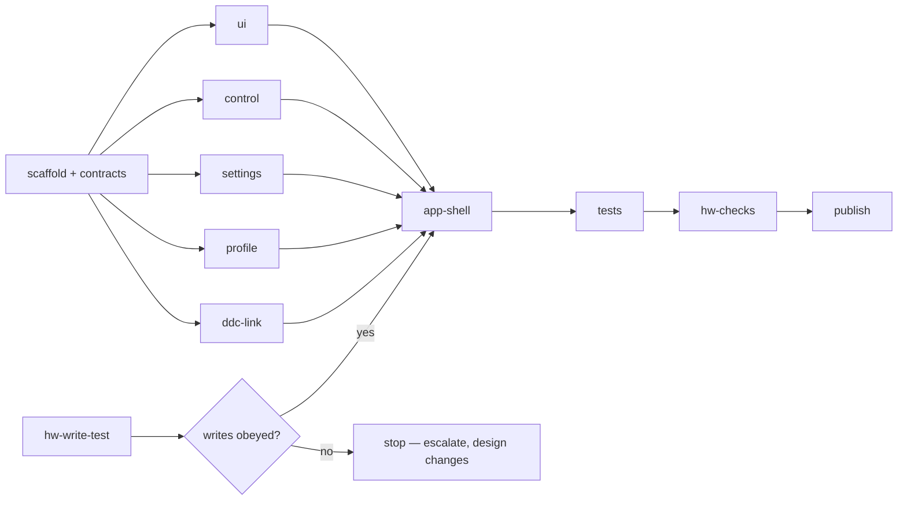

# ThinkVision Control v1 — implementation plan

Spec: [docs/superpowers/specs/2026-10-03-thinkvision-control-design.md](../specs/2026-10-03-thinkvision-control-design.md). The spec's section numbers are referenced as §n.

## Goal

- A tray app that changes every confirmed P32p-20 control (§2) from a panel or a global hotkey, with a ~1 s on-screen box for feedback.
- The six safety rules in §5 are enforced in one place and unit-tested.
- It survives sleep, re-plug and display changes without restarting.
- It ships as one exe that can be copied to the second PC.

**Tier 2:** new project, several responsibilities, a native-interop boundary. Brainstorming is done; the spec is approved.

## Delivery order



The five tasks after `scaffold` can run in parallel: each writes only its own folder, and all of them build against the contracts below, which `scaffold` lands as compiling stubs.

## Target files

**Solution:** [ThinkVisionControl.slnx](../../../ThinkVisionControl.slnx)

**Core** (`net10.0-windows`, no WPF), the testable logic:

| File | Responsibility | Task |
|---|---|---|
| [src/ThinkVisionControl.Core/Ddc/IMonitorLink.cs](../../../src/ThinkVisionControl.Core/Ddc/IMonitorLink.cs) | Interface, `VcpReading`, `DdcException` | scaffold |
| [src/ThinkVisionControl.Core/Ddc/NativeMethods.cs](../../../src/ThinkVisionControl.Core/Ddc/NativeMethods.cs) | dxva2/user32 P/Invoke | ddc-link |
| [src/ThinkVisionControl.Core/Ddc/Dxva2MonitorLink.cs](../../../src/ThinkVisionControl.Core/Ddc/Dxva2MonitorLink.cs) | Real link; finds `LEN62A2`; owns/destroys physical-monitor handles | ddc-link |
| [src/ThinkVisionControl.Core/Ddc/DdcQueue.cs](../../../src/ThinkVisionControl.Core/Ddc/DdcQueue.cs) | Single-consumer queue, spacing, retries | ddc-link |
| [src/ThinkVisionControl.Core/Profile/MonitorCapabilities.cs](../../../src/ThinkVisionControl.Core/Profile/MonitorCapabilities.cs) | Parsed-capabilities type | scaffold |
| [src/ThinkVisionControl.Core/Profile/CapabilitiesParser.cs](../../../src/ThinkVisionControl.Core/Profile/CapabilitiesParser.cs) | Capability string → `MonitorCapabilities` | profile |
| [src/ThinkVisionControl.Core/Profile/ControlDefinition.cs](../../../src/ThinkVisionControl.Core/Profile/ControlDefinition.cs) | Record + enums | scaffold |
| [src/ThinkVisionControl.Core/Profile/ProfileStore.cs](../../../src/ThinkVisionControl.Core/Profile/ProfileStore.cs) | Load embedded profile + `%AppData%` overlay, merge, save overlay | profile |
| [src/ThinkVisionControl.Core/Profile/p32p20.profile.json](../../../src/ThinkVisionControl.Core/Profile/p32p20.profile.json) | Embedded resource: names, kinds, sections, safety, value labels | profile |
| [src/ThinkVisionControl.Core/Settings/AppSettings.cs](../../../src/ThinkVisionControl.Core/Settings/AppSettings.cs) | `AppSettings`, `Preset`, `HotkeyAction` | scaffold |
| [src/ThinkVisionControl.Core/Settings/SettingsStore.cs](../../../src/ThinkVisionControl.Core/Settings/SettingsStore.cs) | JSON load/save, defaults, corrupt → `.bak` | settings |
| [src/ThinkVisionControl.Core/Settings/HotkeyGesture.cs](../../../src/ThinkVisionControl.Core/Settings/HotkeyGesture.cs) | `"Ctrl+Alt+PageUp"` ↔ (modifiers, vk) | settings |
| [src/ThinkVisionControl.Core/Logging/FileLog.cs](../../../src/ThinkVisionControl.Core/Logging/FileLog.cs) | Rolling 1 MB log | settings |
| [src/ThinkVisionControl.Core/Control/SafetyPolicy.cs](../../../src/ThinkVisionControl.Core/Control/SafetyPolicy.cs) | Pure §5 rule evaluation | control |
| [src/ThinkVisionControl.Core/Control/ControlService.cs](../../../src/ThinkVisionControl.Core/Control/ControlService.cs) | The only write path; cache, events, throttle, presets, resets | control |
| [src/ThinkVisionControl.Core/Control/BackupStore.cs](../../../src/ThinkVisionControl.Core/Control/BackupStore.cs) | Timestamped backup JSON; latest lookup | control |
| [src/ThinkVisionControl.Core/Finder/VendorCodeFinder.cs](../../../src/ThinkVisionControl.Core/Finder/VendorCodeFinder.cs) | Snapshot + diff of vendor codes | control |

**App** (`net10.0-windows`, WPF + `UseWindowsForms` for `NotifyIcon`):

| File | Responsibility | Task |
|---|---|---|
| [src/ThinkVisionControl/App.xaml(.cs)](../../../src/ThinkVisionControl/App.xaml.cs) | Single-instance mutex, composition root, no main window | app-shell |
| [src/ThinkVisionControl/Tray/TrayIcon.cs](../../../src/ThinkVisionControl/Tray/TrayIcon.cs) | Normal/grey icon, tooltip, left-click panel, right-click Exit | app-shell |
| [src/ThinkVisionControl/Hotkeys/HotkeyManager.cs](../../../src/ThinkVisionControl/Hotkeys/HotkeyManager.cs) | `RegisterHotKey` on a message-only `HwndSource`; reports failed registrations | app-shell |
| [src/ThinkVisionControl/Platform/StartupRegistration.cs](../../../src/ThinkVisionControl/Platform/StartupRegistration.cs) | `HKCU\Software\Microsoft\Windows\CurrentVersion\Run` value | app-shell |
| [src/ThinkVisionControl/Platform/DisplayEvents.cs](../../../src/ThinkVisionControl/Platform/DisplayEvents.cs) | `WM_DISPLAYCHANGE` + `PowerModeChanged.Resume` → `ReconnectAsync` | app-shell |
| [src/ThinkVisionControl/Ui/PanelWindow.xaml(.cs)](../../../src/ThinkVisionControl/Ui/PanelWindow.xaml.cs), [PanelViewModel.cs](../../../src/ThinkVisionControl/Ui/PanelViewModel.cs) | Flyout per §3.3, built from profile + capabilities | ui |
| [src/ThinkVisionControl/Ui/OsdWindow.xaml(.cs)](../../../src/ThinkVisionControl/Ui/OsdWindow.xaml.cs) | Click-through, topmost, no-activate feedback box | ui |
| [src/ThinkVisionControl/Ui/FinderWindow.xaml(.cs)](../../../src/ThinkVisionControl/Ui/FinderWindow.xaml.cs) | Snapshot → "change one setting" → diff → name and save | ui |
| [src/ThinkVisionControl/Ui/Theme.xaml](../../../src/ThinkVisionControl/Ui/Theme.xaml) | Dark brushes and control styles | ui |

**Tests:** [tests/ThinkVisionControl.Tests/](../../../tests/ThinkVisionControl.Tests/) — xUnit; references Core only; includes `FakeMonitorLink`.

## Pinned contracts (landed by `scaffold`)

```csharp
// Ddc
public interface IMonitorLink : IDisposable {
    bool TryConnect();                 // false if no LEN62A2 present
    bool IsConnected { get; }
    string ReadCapabilities();         // throws DdcException
    VcpReading Read(byte code);        // throws DdcException
    void Write(byte code, uint value); // throws DdcException
}
public readonly record struct VcpReading(uint Current, uint Max);
public sealed class DdcException(string message) : Exception(message);
public sealed class DdcQueue(IMonitorLink link) : IDisposable {
    public Task<T> Run<T>(Func<IMonitorLink, T> op, CancellationToken ct = default); // serial, ≥50 ms gap, 3 tries, then DdcException
}

// Profile
public sealed record MonitorCapabilities(string Model, IReadOnlyDictionary<byte, IReadOnlyList<byte>?> Vcp) {
    public bool Supports(byte code);
    public bool AllowsValue(byte code, uint value); // null list ⇒ continuous ⇒ true
}
public enum ControlKind { Range, Enum, Action }
public enum PanelSection { Main, Advanced, Hidden }
public enum SafetyClass { Normal, ConfirmRequired, NeverWrite, ReadOnlyUntilNamed }
public sealed record ControlDefinition(byte Code, string Name, ControlKind Kind, PanelSection Section,
    SafetyClass Safety, IReadOnlyDictionary<byte, string> ValueLabels, string? ConfirmMessage = null);

// Settings
public enum HotkeyAction { BrightnessUp, BrightnessDown, ContrastUp, ContrastDown, DayPreset, NightPreset,
    InputHdmi, InputDp, InputUsbC, SwitchToMe, OpenPanel }
public sealed record Preset(string Name, uint Brightness, uint Contrast, byte? ColourMode);
public sealed record AppSettings(IReadOnlyDictionary<HotkeyAction, string> Hotkeys, Preset Day, Preset Night,
    byte ThisMachineInput, bool StartWithWindows);

// Control
public enum WriteOutcome { Ok, NeedsConfirmation, Blocked, NotResponding }
public sealed record WriteResult(WriteOutcome Outcome, string Message, uint? Value = null);
// ControlService public surface:
//   event Action<byte, uint> ValueChanged; event Action<bool> RespondingChanged;
//   bool IsResponding; MonitorCapabilities? Capabilities; IReadOnlyDictionary<byte, ControlDefinition> Controls;
//   bool TryGetCached(byte code, out VcpReading r);
//   Task StartAsync();  Task ReconnectAsync();  Task RefreshAsync(IEnumerable<byte> codes);
//   Task<WriteResult> SetAsync(byte code, uint value, bool confirmed = false);
//   Task<WriteResult> StepAsync(byte code, int delta);          // clamps 0..Max
//   void SetThrottled(byte code, uint value);                   // latest-wins, ≤10/s
//   Task<WriteResult> ApplyPresetAsync(Preset p);
//   Task<WriteResult> RestoreLatestBackupAsync();
```

**Profile JSON shape.** Codes and values are hex strings. The overlay has the same shape and is merged per code, with the overlay winning.

```json
{ "edidId": "LEN62A2",
  "controls": [ { "code": "0x60", "name": "Input", "kind": "Enum", "section": "Main", "safety": "Normal",
                  "values": { "0x11": "HDMI", "0x0F": "DisplayPort", "0x31": "USB-C" } } ] }
```

The default `AppSettings` match §3.4 and §3.5 exactly. `ThisMachineInput` defaults to `0x11`. Night `ColourMode` is `null` until Low Blue Light is identified.

## Implementation steps

1. **hw-write-test** (do first; also the gate). Extend the scratch probe script with `SetVCPFeature`. Write `0x10` = 20, read it back, ask the user to confirm the screen changed, then write `0x10` = 0 and read back. If the monitor ignores writes, stop and escalate: the design assumes writes work.
2. **scaffold:**
   - Run `winget install Microsoft.DotNet.SDK.10`. This shows a UAC prompt.
   - Create branch `feature/thinkvision-control`.
   - Create `dotnet new sln --format slnx`, a `classlib` (Core), a `wpf` (App) with `<UseWindowsForms>true</UseWindowsForms>`, and an `xunit` project.
   - Add the project references and add `Profile/p32p20.profile.json` as `<EmbeddedResource>`.
   - Land every pinned contract above with `throw new NotImplementedException()` bodies so that the parallel tasks build against the real types.
3. **ddc-link:**
   - Matching: for each `HMONITOR`, take `GetMonitorInfo` → `szDevice` and enumerate `EnumDisplayDevices(szDevice, i, EDD_GET_DEVICE_INTERFACE_NAME)`. Physical monitor *i* is the target when that `DeviceID` contains `LEN62A2`.
   - `Read` and `Write` return `false` from dxva2 on failure and throw `DdcException`.
   - Call `DestroyPhysicalMonitors` on reconnect and on dispose.
   - `DdcQueue` runs one long-lived worker task fed by a `Channel`.
   - **Measured on the real monitor (hw-write-test):** after a write that changes a value, reads fail for about 230–300+ ms (0→20 still failed at 300 ms). Rules:
     - After any `Write`, the next command waits at least 400 ms.
     - Reads retry up to 5 times with a 150 ms gap before throwing `DdcException`.
     - Writes are not read back immediately. `ControlService` updates its cache optimistically and confirms on the next refresh.
4. **profile:**
   - The parser handles nested parentheses and hex tokens, and must survive the real `C6(...)` payload and the firmware bytes in `04(...)`.
   - `ProfileStore` resolves names and safety. Codes from the capabilities that are missing from the profile become Hidden + `ReadOnlyUntilNamed`.
5. **settings:**
   - `SettingsStore(string dir)` is used with `%AppData%\ThinkVisionControl`.
   - `HotkeyGesture` handles Ctrl/Alt/Shift/Win, `A`–`Z`, `0`–`9`, `F1`–`F24`, PageUp/PageDown/Home/End and arrows, and gives a round-trip string.
6. **control:**
   - `SafetyPolicy.Evaluate(def, caps, code, value, max, confirmed)` returns Allow(clamped) / NeedsConfirmation(msg) / Block(reason), covering the §5 rules in order.
   - `ControlService` calls `BackupStore` before any of `0x04/0x05/0x08` and after confirmation.
   - Any `DdcException` leads to `IsResponding = false` and a reconnect timer every 5 s.
   - `VendorCodeFinder.Diff(before, after)` returns `CodeChange(Code, Before, After)`. Naming a code calls `ProfileStore.SaveOverlay`.
7. **ui:**
   - The panel is generated from `Controls` plus `Capabilities`, so a newly named vendor code appears without UI code changes. Main/Advanced follow `PanelSection`.
   - Confirm dialogs come from `WriteOutcome.NeedsConfirmation`.
   - The RGB sliders show only when `0x14` = User/Custom.
   - `OsdWindow` uses `WS_EX_TRANSPARENT | WS_EX_NOACTIVATE | WS_EX_TOOLWINDOW` and auto-hides after 1 s.
8. **app-shell:**
   - Composition in `App.OnStartup`.
   - HotkeyAction → ControlService mapping:
     - Brightness ±10, Contrast ±5 via `StepAsync`.
     - Inputs via `SetAsync(0x60, …)`.
     - `SwitchToMe` uses `ThisMachineInput`.
   - When a hotkey fails it shows "Monitor not responding" in the OSD, with no dialog.
9. **tests**, then **hw-checks** and **publish** (see Verification).

Every implementation subagent brief includes:

```text
Implement only. Do not author tests and do not run any test suite — `dotnet build` is the only check you may run.
The orchestrator verifies once, after all agents land. Touch only the files listed for your task.
```

## Key design decisions

- **The Core/App split** keeps all branching logic testable without WPF or hardware.
- **The real monitor is never touched by automated tests.** `FakeMonitorLink` is seeded with the real §2 capability string.
- **`ControlService` is the single write path,** so the safety rules cannot be bypassed by the UI or by hotkeys.
- **Action codes (`0x04/05/08`) ignore their capability value list.** `04(4C 42 31 2E 32)` is firmware text, not allowed values. `SafetyPolicy` treats `ControlKind.Action` as write-1-only.
- **Unknown codes default to read-only.** Writability comes only from the profile or overlay (finder naming), never from merely appearing in the capability string.
- **NotifyIcon from WinForms** instead of a third-party tray package: no extra dependency.
- **The panel is data-driven** from the profile, so the finder's output reaches the UI without code changes.

## Verification

| Phase | Commands / checks |
|---|---|
| Agents | `dotnet build ThinkVisionControl.slnx` only |
| Reconcile | `dotnet build ThinkVisionControl.slnx -warnaserror` |
| Tests | `dotnet test tests/ThinkVisionControl.Tests` until green |
| Final | `dotnet publish src/ThinkVisionControl -c Release -r win-x64 --self-contained -p:PublishSingleFile=true -o publish`; run `publish/ThinkVisionControl.exe` |

**Test scenarios:**
- **Parser:** the real string gives `60 → [11,0F,31]`, `10 → null` and `CA → [01,02]`, and does not throw on `C6`.
- **Profile:** the overlay renames a code. A code missing from the profile becomes Hidden + ReadOnlyUntilNamed.
- **Safety:**
  - `0xCA` is Blocked.
  - `0x60 = 0x13` is Blocked because it is not in the list.
  - `0x10 = 150` is clamped to 100.
  - `0xD6 = 05` without confirmation needs confirmation.
  - `0x04` with confirmation is allowed, and the backup is written first.
  - An unnamed `0xE0` is Blocked.
- **Control:**
  - A `StepAsync` from 95 by +10 gives 100.
  - A fake failure ×3 gives `NotResponding` and raises `RespondingChanged(false)`.
  - Throttle: 20 rapid `SetThrottled` calls lead to ≤3 writes, and the last value wins.
- **Settings:** a missing file gives the §3.4 defaults. A corrupt file gives the defaults and is renamed `.bak`. Hotkey strings round-trip.
- **Finder:** a diff of two snapshots returns only the changed codes.

**Hardware (hw-checks, with the user watching):**
- Every Main and Advanced control changes the monitor and reads back.
- Step 0x14 through its 8 values and 0x86 through 2, recording the OSD names in the profile.
- Sleep/resume and HDMI re-plug: the panel works again within about 5 s without a restart.
- Hotkeys work while another app has focus, and the OSD box appears.

## Open questions

- **Assumption:** that the `EnumDisplayDevices` DeviceID contains `LEN62A2` and that its index matches the physical-monitor order. Verified in ddc-link on this laptop; the fallback is matching the dxva2 description "Lenovo P32p-20".
- **Assumption:** that Ctrl+Alt+PageUp/PageDown/Home/End/F1–F3 are free on this laptop. HotkeyManager reports conflicts if not.
- The .NET SDK install needs admin (UAC), which only the user can approve.
- The inactive-input switching test (§6) waits for the PC to be connected. It is not part of v1 verification.
- The 0x14 colour-mode names and 0x86 aspect names are unknown until hw-checks. The Night preset's colour mode stays `null` until then.
