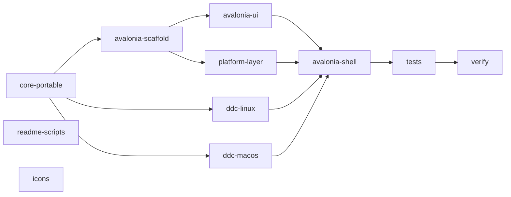

# macOS and Linux — implementation plan

Spec: [2026-10-05-cross-platform-design.md](../specs/2026-10-05-cross-platform-design.md) (§n below). **Tier 2.** Branch: `feature/thinkvision-control` (continue).

## Goal

- One Core and three monitor links (Windows, Linux, macOS) behind the existing `IMonitorLink`.
- An Avalonia app that runs on Windows, macOS (arm64) and Linux (x64), with the same pages, states, safety rules and commands as the WPF app.
- Missing OS capabilities degrade as in spec §4.2, and the setup cards from §5 explain them.
- Each OS builds from source with the README commands. WPF remains the Windows app.

## Delivery order



- `core-portable` lands first and is blocking. The orchestrator does it, because it moves files between projects.
- **Wave 1 (parallel):** `avalonia-scaffold`, `ddc-linux`, `ddc-macos`.
- **Wave 2 (parallel):** `avalonia-ui`, `platform-layer`.
- `avalonia-shell` is done by the orchestrator.
- `readme-scripts` and `icons` run in parallel with any wave.

## Projects and files

| Path | Task | Responsibility |
|---|---|---|
| `src/ThinkVisionControl.Core/` (→ `net10.0`) | core-portable | Drop the Windows-only code. Add `Mccs/DdcPacket.cs` and `Ddc/LinkFailure.cs` |
| `src/ThinkVisionControl.Ddc.Windows/` (new, `net10.0-windows`) | core-portable | `Dxva2MonitorLink`, `NativeMethods`, moved verbatim |
| `src/ThinkVisionControl.Ddc.Linux/` (new, `net10.0`) | ddc-linux | `I2cMonitorLink`, `Libc` P/Invoke, `Edid`, `I2cBusLocator` |
| `src/ThinkVisionControl.Ddc.MacOS/` (new, `net10.0`) | ddc-macos | `IoAvMonitorLink`, `IoKit`/`CoreFoundation`/`CoreGraphics` P/Invoke, `AvServiceLocator` |
| `src/ThinkVisionControl/` (WPF) | core-portable | References `Ddc.Windows`; no other change |
| `src/ThinkVisionControl.Avalonia/` (new, `net10.0`) | scaffold / ui / platform / shell | The app. `Platform/{Windows,MacOS,Linux}/`, `Views/`, `ViewModels/`, `Assets/Fonts/FluentSystemIcons-Regular.ttf` (MIT) |
| `tests/ThinkVisionControl.Tests/` (→ `net10.0`) | core-portable / tests | Existing tests plus codec and helper tests |
| `README.md` (new), `scripts/make-macos-app.sh`, `packaging/linux/60-thinkvision-i2c.rules`, `packaging/linux/thinkvision-control.desktop` | readme-scripts | Build from source |

## Pinned contracts

```csharp
// Core — codec (core-portable). Bytes as they go on the wire after the 0x51 source byte (Linux) / as the
// IOAVService payload (macOS). Checksums: request = 0x6E ^ 0x51 ^ payload; reply = 0x50 ^ reply bytes.
public static class DdcPacket {
    public static byte[] GetVcp(byte code, bool includeSourceInChecksum = true);
    public static byte[] SetVcp(byte code, ushort value, bool includeSourceInChecksum = true);
    public static byte[] CapabilitiesRequest(ushort offset, bool includeSourceInChecksum = true);
    public static bool TryParseVcpReply(ReadOnlySpan<byte> reply, byte expectedCode, out VcpReading reading); // false on bad checksum/opcode/code or "unsupported" result
    public static bool TryParseCapabilitiesFragment(ReadOnlySpan<byte> reply, ushort expectedOffset, out ReadOnlySpan<byte> data); // empty data = end
}

// Core — why a link isn't working (core-portable). Links set it; ControlService exposes it.
public enum LinkFailure { None, NotFound, PermissionDenied, ModuleMissing, UnsupportedPort }
// IMonitorLink gains:  LinkFailure LastFailure { get; }   (Windows: None/NotFound only)
// ControlService gains: LinkFailure StatusReason { get; }  (raised with StatusChanged)

// Avalonia — platform layer (avalonia-scaffold lands these as interfaces + Null implementations).
public interface IMonitorEvents : IDisposable { event Action? Changed; }                 // plug/unplug/reconfigure/wake
public interface IHotkeys : IDisposable {
    bool IsAvailable { get; }                                                            // false → setup card
    IReadOnlyCollection<HotkeyAction> Register(IReadOnlyDictionary<HotkeyAction, string> map); // returns failed
    void Suspend();
    event Action<HotkeyAction>? Pressed;
}
public interface ITray : IDisposable {
    bool IsHostAvailable { get; }                                                        // GNOME without SNI host → false
    void Show(Func<IReadOnlyList<TrayMenuItem>> menu, Action primaryClick);
    void SetStatus(MonitorStatus status);
    Point? FlyoutOrigin(Size flyout);                                                    // null → no flyout on this OS
}
public sealed record TrayMenuItem(string Label, Action? Run, bool IsDefault = false, bool IsSeparator = false);
public interface IOsd { void ShowMessage(string text); void ShowLevel(string label, uint value, uint max); event Action? Hidden; }
public interface IAutostart { bool IsEnabled { get; } void Set(bool enabled); }
public interface IQuickActions { void Publish(); }                                       // jump list / menu items / .desktop note
public interface ISingleInstance : IDisposable { bool TryBecomePrimary(); bool TrySend(IReadOnlyList<string> args); event Action<string[]>? Received; }
public interface IThemeInfo { bool IsDark { get; } Color? Accent { get; } event Action? Changed; }
public sealed record PlatformServices(IMonitorEvents MonitorEvents, IHotkeys Hotkeys, ITray Tray, IOsd Osd,
    IAutostart Autostart, IQuickActions QuickActions, ISingleInstance SingleInstance, IThemeInfo Theme, Func<IMonitorLink> CreateLink);
```

## Implementation steps

1. **core-portable** (orchestrator):
   - Create `Ddc.Windows` and move `Dxva2MonitorLink.cs` and `NativeMethods.cs` into it.
   - Switch Core and Tests to `net10.0`. Tests reference Core only.
   - Add `DdcPacket` and `LinkFailure`. `ControlService` maps `link.LastFailure` to `StatusReason` whenever the status changes.
   - **Gate:** the WPF app builds and runs as before, and all 76 tests pass.
2. **avalonia-scaffold:**
   - Project setup: `Avalonia.Desktop` 12.1.x and `FluentAvaloniaUI` 3.1.x, with exact pinned versions.
   - `Program.cs` selects X11 on Linux (`X11PlatformOptions`, no native Wayland), sets `MacOSPlatformOptions.ShowInDock = false`, and uses the Win32 defaults.
   - Bundle `FluentSystemIcons-Regular.ttf` as `avares://` and add an `IconFont` resource.
   - Background rule (spec §4.1): Mica on Windows 11; otherwise `TransparencyLevelHint = None` with a solid background.
   - Accent: `IThemeInfo.Accent` ?? ember.
   - Land the pinned interfaces plus `Null*` implementations and a `PlatformServices.Create()` that returns the Null set, so `ui` and `platform` can build in parallel.
3. **ddc-linux:**
   - `I2cBusLocator` lists `/dev/i2c-*`, prefers buses named by `/sys/class/drm/*/ddc`, reads EDID at 0x50 and matches `LEN`/`0x62A2` with `Edid.Matches(bytes, "LEN", 0x62A2)`.
   - `I2cMonitorLink`:
     - `open(O_RDWR)`, `ioctl(I2C_SLAVE=0x0703, 0x37)`, then `write` the `0x51` + codec payload.
     - Sleep 50 ms, `read` 11 bytes, and parse with `DdcPacket`.
     - Wrap each transaction in `flock(LOCK_EX)`.
     - Map `EACCES` to `PermissionDenied`, and "no `/dev/i2c-*`" to `ModuleMissing`.
     - Capabilities come from the fragment loop.
4. **ddc-macos:**
   - `AvServiceLocator`:
     - finds the online display with vendor `0x30AE` and model `0x62A2` (CoreGraphics);
     - walks the IORegistry (`IOServiceGetMatchingServices` → `IORegistryEntry*`) to the matching `DCPAVServiceProxy` with `Location=External`, using the m1ddc method;
     - then calls `IOAVServiceCreateWithService`.
   - `IoAvMonitorLink`:
     - writes twice, each after a 10 ms sleep;
     - waits 50 ms before reading, and retries 5 times at 20 ms intervals;
     - tries the spec checksum first, then the legacy form, and remembers which worked;
     - uses the M1 / base M2 HDMI variant (0xB7) when the standard path fails, and maps that failure to `UnsupportedPort`.
   - **Cannot run here:** it is built and unit-tested through its pure helpers only. The hardware check is listed under verify.
5. **avalonia-ui:**
   - Port `PanelViewModel` to `ViewModels/MainViewModel.cs`. It is the same logic (states, InfoBar with 1 s hold, live drag via `BeginDrag`/`DragTo`/`EndDragAsync`, presets, finder, hotkey save) using the Avalonia `Dispatcher`.
   - Views:
     - `MainWindow` with `FANavigationView`, plus `DisplayPage`, `MonitorPage` and `AppSettingsPage` using `FASettingsExpander`;
     - `FAContentDialog`s with the spec §5 wording, and a `ShortcutEditor` dialog;
     - `FlyoutWindow` and `OsdWindow`;
     - `SetupCards` on AppSettings, driven by `StatusReason`, `IHotkeys.IsAvailable`, `ITray.IsHostAvailable` and the PowerDevil probe.
   - Screenshots under WSL Ubuntu (X11) and on Windows go to `docs/previews/avalonia/` and are compared with the mockups.
6. **platform-layer:**
   - **Windows:** reuse the WPF-era code: the `MessageWindow`-based hotkeys and arrival watcher, Run key, jump list, named pipe and registry theme. The tray is Avalonia `TrayIcon`, with the flyout anchored by the existing `TrayAnchor` logic.
   - **macOS:**
     - Carbon `RegisterEventHotKey` via P/Invoke, with a run-loop handler;
     - `CGDisplayRegisterReconfigurationCallback` plus a wake notification;
     - `SMAppService` through the Objective-C runtime (`objc_msgSend`);
     - menu-bar `TrayIcon` with the flyout under the status item (cursor fallback);
     - OSD window `ignoresMouseEvents` through the native handle;
     - Unix socket in `$TMPDIR`.
   - **Linux:**
     - X11 `XGrabKey` (libX11) when `DISPLAY` is set and the session is not Wayland;
     - on Wayland, the GlobalShortcuts portal through Tmds.DBus (MIT) after `host.portal.Registry.Register("thinkvision-control")`, otherwise `IsAvailable = false`;
     - tray: `IsHostAvailable` from the DBus name `org.kde.StatusNotifierWatcher`;
     - OSD: an X11 window, or `org.freedesktop.Notifications` with `replaces_id` on Wayland;
     - autostart `.desktop`, a lock file plus Unix socket in `$XDG_RUNTIME_DIR`, and the theme from the portal `org.freedesktop.appearance`.
   - Each implementation lives in its own file. No OS API is called unless `OperatingSystem.IsX()` is true.
7. **avalonia-shell** (orchestrator):
   - Port the `App.xaml.cs` flow to `App.axaml.cs`: headless command mode, `--startup` tray-only, exit-on-close, lazy window and flyout, retry bursts and `IMonitorEvents` → `Recheck`.
   - `PlatformServices.Create()` picks the OS set, and `CreateLink` returns the right `IMonitorLink`.
8. **readme-scripts:** spec §6.
   - The README covers the steps per OS.
   - `make-macos-app.sh` turns `dotnet publish -r osx-arm64` output into `ThinkVision Control.app`: `Info.plist` (`LSUIElement`, `CFBundleIdentifier`, icon), `Contents/MacOS` and `Resources`.
   - The udev rule `KERNEL=="i2c-[0-9]*", TAG+="uaccess"`.
   - A `.desktop` file with `Actions=Day;Night;SwitchToMe`.
9. **icons:**
   - Wait for the user's next dark-icon round, then export the light/dark `.ico`, `.icns` and SVG.
   - Windows (both apps):
     - `EnsureShortcut` writes `%AppData%\ThinkVisionControl\icon-{light|dark}.ico` and points the Start Menu shortcut's `IconLocation` at the one for the current Windows theme, rewriting it on theme change;
     - the window/taskbar icon follows the theme at runtime.
   - macOS: light and dark variants in the `.app` bundle.
   - Linux: the light icon.

Implementation brief boilerplate (every subagent):

```text
Implement only. Do not author tests and do not run any test suite — `dotnet build` of your projects is the only check you may run.
The orchestrator verifies once, after all agents land. Touch only the files listed for your task.
```

## Key design decisions

- **The codec lives in Core.** Linux and macOS share the packet logic and its tests. Windows keeps dxva2 framing.
- **Failure reasons are data, not exceptions.** `LinkFailure` flows to `StatusReason`, so the setup cards are just bindings.
- **No libddcutil and no helper binaries.** All P/Invoke is MIT-clean, so there is nothing to sign and no GPL.
- **The Null platform implementations** let the UI and the platform layer build in parallel. They also define the degraded behaviour, which is "unavailable plus a card".
- **X11 backend on Linux.** Native Wayland can't position or keep windows on top (research), so only the portal hotkeys and notifications use Wayland-specific paths.
- **The view model is a port, not shared with WPF.** WPF retires at the switch gates, so a shared abstraction would be throwaway.

## Verification

| Phase | Commands / checks |
|---|---|
| Agents | `dotnet build <their project>` |
| Reconcile | `dotnet build ThinkVisionControl.slnx -warnaserror`; `dotnet build src/ThinkVisionControl.Avalonia -r osx-arm64` and `-r linux-x64` |
| Tests | `dotnet test tests/ThinkVisionControl.Tests` |
| Final, here | `dotnet publish src/ThinkVisionControl.Avalonia -c Release -r linux-x64 --self-contained`, then run it in WSL Ubuntu (pages, states, setup cards render, no see-through window, icons visible). Windows: run the Avalonia app and record the §7 gate numbers next to WPF's. The WPF app is unchanged: smoke-run and confirm the 24 MB login figure still holds |

**Test scenarios:**
- **Codec:**
  - The Get request for 0x10 matches the byte sequence from the research, with the checksum in both modes.
  - A Set encodes the high and low bytes correctly.
  - A valid reply parses to current and max.
  - A bad checksum, a wrong VCP code or an "unsupported" result returns false.
  - The capabilities fragments assemble the real P32p-20 string from §2 of the first spec; an empty fragment ends the loop.
- **EDID:** the real `LEN62A2` header matches; another vendor doesn't.
- **Bus locator:** given a fake sysfs listing, the `ddc` symlink bus is preferred and phantom buses are skipped.
- **Status reason:** the fake link's `PermissionDenied` gives `NotResponding` with `StatusReason == PermissionDenied`.

**Hardware (not possible from this machine; checklist goes in the README):**
- Linux live USB with the P32p-20 on HDMI.
- KDE session.
- Apple Silicon Mac on USB-C.

## Open questions

- The dark icon art is waiting on the user's next iteration notes.
- FluentAvalonia NativeAOT compatibility is unverified and is measured during verify for the Windows gates.
- **Assumption:** macOS P/Invoke into private IOKit symbols resolves by name through `NativeLibrary.Load("/System/Library/Frameworks/IOKit.framework/IOKit")`. Research marked it untested. The first Mac run confirms it.
- **Assumption:** the GNOME GlobalShortcuts portal accepts a host app registered via `Registry.Register`. Unconfirmed; the fallback is the setup card.
- Ubuntu 24.04 ships GNOME 46, so it has no portal and gets the setup card.
