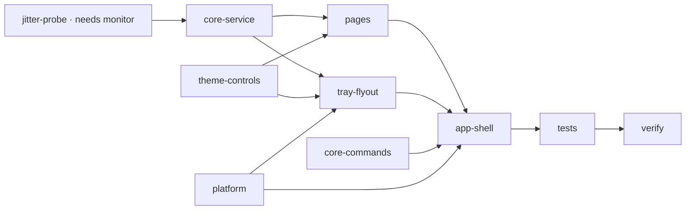

# Windows 11 redesign — implementation plan

Spec: [2026-10-05-windows11-redesign-design.md](../specs/2026-10-05-windows11-redesign-design.md) (§n below). Mockup: [thinkvision-control-ui.html](../../mockups/thinkvision-control-ui.html) variant A. **Tier 2.**

## Goal

- Layout A rendered on the built-in Fluent theme, matching the mockup in light and dark.
- Every card visible in all four states. Monitor controls disabled with one InfoBar giving the reason; app settings always enabled.
- Live sliders with no jitter. During a drag, writes are coalesced and nothing is read back; one verified write on release.
- A jump list and command-line verbs that work with the app closed; a tray flyout in background mode.
- A login launch in background mode creates no window (about 12 MB private). No polling while the monitor is absent. EcoQoS while hidden.

## Delivery order



- **Wave 1 (parallel):** `core-commands`, `theme-controls` and `platform`. `jitter-probe` runs at the same time but needs the monitor plugged in, and `core-service` follows it.
- **Wave 2 (parallel):** `pages` and `tray-flyout`.
- **`app-shell`** is done by the orchestrator.

Write sets are disjoint per task (see the file map).

## Target files

| File | Task | Responsibility |
|---|---|---|
| [src/ThinkVisionControl.Core/Control/ControlService.cs](../../../src/ThinkVisionControl.Core/Control/ControlService.cs) | core-service | Offline `Controls`, `RequestReconnect()`, drag API, status |
| `src/ThinkVisionControl.Core/Control/CapabilitiesCache.cs` (new) | core-service | Load/save `capabilities.txt` |
| `src/ThinkVisionControl.Core/Control/RetryBurst.cs` (new) | core-service | 0.5/1/2/4/8 s schedule, injectable delay |
| `src/ThinkVisionControl.Core/Profile/ProfileStore.cs` | core-service | `SynthesizeCapabilities()` from profile labels |
| `src/ThinkVisionControl.Core/Commands/CommandLine.cs` (new) | core-commands | Parse args into `AppCommand` |
| [src/ThinkVisionControl.Core/Settings/SettingsStore.cs](../../../src/ThinkVisionControl.Core/Settings/SettingsStore.cs), `AppSettings.cs` | core-commands | `Defaults.BackgroundMode = false`; a file *missing* the field still reads `true` (legacy) |
| [src/ThinkVisionControl/App.xaml](../../../src/ThinkVisionControl/App.xaml), [Ui/Theme.xaml](../../../src/ThinkVisionControl/Ui/Theme.xaml) | theme-controls | `ThemeMode="System"`, type ramp, control styles |
| `src/ThinkVisionControl/Ui/Controls/*.cs` + `Ui/Controls/Controls.xaml` (new) | theme-controls | SettingsCard, InfoBar, ContentDialogHost, NavigationPane, ToggleSwitch and SettingsExpander styles |
| [src/ThinkVisionControl/Ui/WindowsThemeManager.cs](../../../src/ThinkVisionControl/Ui/WindowsThemeManager.cs) | theme-controls | Shrinks to `IsTaskbarLight` + `Changed` event (palette and title bar removed) |
| `src/ThinkVisionControl/Platform/MonitorArrivalWatcher.cs` (new) | platform | Message-only HwndSource + `RegisterDeviceNotification(GUID_DEVINTERFACE_MONITOR)`, raises `Arrived` |
| `src/ThinkVisionControl/Platform/EfficiencyMode.cs` (new) | platform | `SetProcessInformation` ProcessPowerThrottling on/off |
| `src/ThinkVisionControl/Platform/TrayAnchor.cs` (new) | platform | `Shell_NotifyIconGetRect` + `CalculatePopupWindowPosition` → `Rect` |
| [src/ThinkVisionControl/ThinkVisionControl.csproj](../../../src/ThinkVisionControl/ThinkVisionControl.csproj) | platform | Publish props (R2R, SatelliteResourceLanguages=en, no compression) |
| [src/ThinkVisionControl/Platform/DisplayEvents.cs](../../../src/ThinkVisionControl/Platform/DisplayEvents.cs) | platform | Calls `RequestReconnect()` instead of `ReconnectAsync` |
| [Ui/PanelWindow.xaml(.cs)](../../../src/ThinkVisionControl/Ui/PanelWindow.xaml.cs), [Ui/PanelViewModel.cs](../../../src/ThinkVisionControl/Ui/PanelViewModel.cs) | pages | Layout A, states, live sliders, ContentDialogs |
| [Ui/FinderWindow.xaml(.cs)](../../../src/ThinkVisionControl/Ui/FinderWindow.xaml.cs), [Ui/HotkeyCaptureWindow.xaml(.cs)](../../../src/ThinkVisionControl/Ui/HotkeyCaptureWindow.xaml.cs) | pages | Fluent restyle; shortcut dialog per spec §4 (Save disabled until valid, Reset, Clear) |
| `src/ThinkVisionControl/Ui/FlyoutWindow.xaml(.cs)` (new) | tray-flyout | Acrylic flyout bound to the shared `PanelViewModel` |
| [src/ThinkVisionControl/Tray/TrayIcon.cs](../../../src/ThinkVisionControl/Tray/TrayIcon.cs) | tray-flyout | Monochrome theme-adaptive icon, state overlay and tooltip, new menu, `TaskbarCreated` |
| [Ui/OsdWindow.xaml(.cs)](../../../src/ThinkVisionControl/Ui/OsdWindow.xaml.cs) | tray-flyout | 8 px, 1 px stroke, BodyLarge, 167 ms fade |
| [src/ThinkVisionControl/App.xaml.cs](../../../src/ThinkVisionControl/App.xaml.cs), `Platform/CommandPipe.cs` (new), [Platform/StartupRegistration.cs](../../../src/ThinkVisionControl/Platform/StartupRegistration.cs) | app-shell | Startup modes, pipe, jump list, lifecycle |

## Pinned contracts

```csharp
// Core — ControlService additions (core-service)
public ControlService(DdcQueue queue, ProfileStore profiles, BackupStore backups, CapabilitiesCache cache);
// Controls/Capabilities are populated in the constructor from cache.Load() ?? profiles.SynthesizeCapabilities();
// real capabilities replace them on connect and are saved to the cache.
public void RequestReconnect();                       // starts (or restarts) a retry burst; no-op while Connected
public void BeginDrag(byte code);                     // ValueChanged for `code` is suppressed until EndDragAsync completes
public void DragTo(byte code, uint value);            // latest-wins, ≤1 write in flight per code, no read-back
public Task<WriteResult> EndDragAsync(byte code, uint value); // final write, then one verify read after settle
// SetAsync keeps its signature; Range verify stays for non-drag writes (hotkeys, presets).
// The 5 s reconnect Timer is deleted; after any failure, ControlService calls RequestReconnect() itself.

public sealed class CapabilitiesCache(string directory) { public string? Load(); public void Save(string raw); }
public static class RetryBurst { public static readonly TimeSpan[] Delays; } // 0.5, 1, 2, 4, 8 s

// Core — commands (core-commands)
public abstract record AppCommand {
    public sealed record Show : AppCommand;
    public sealed record Preset(bool Night) : AppCommand;
    public sealed record Input(byte? Code) : AppCommand;        // null = this PC's input
    public sealed record Step(byte Code, int Delta) : AppCommand;
}
public static class CommandLine {
    public static (AppCommand Command, bool Startup) Parse(IReadOnlyList<string> args); // unknown → Show
    public static string[] Format(AppCommand command);                                  // for pipe + jump list
}

// App — platform
public sealed class MonitorArrivalWatcher(Action arrived) : IDisposable;
public static class EfficiencyMode { public static void Set(bool efficient); }
public static class TrayAnchor { public static Point? PopupOrigin(IntPtr trayWindow, uint iconId, Size popupSize); }

// App — UI
public PanelViewModel(ControlService control, SettingsStore settingsStore, ProfileStore profiles,
    Func<IReadOnlyCollection<HotkeyAction>> failedHotkeys, Action<AppSettings> settingsChanged); // unchanged; shared by window + flyout
public PanelWindow(PanelViewModel vm, Action suspendHotkeys, Action resumeHotkeys); public void ShowMainWindow(); // always really closes
public FlyoutWindow(PanelViewModel vm, Action openSettings); public void ShowAt(Point origin);
public TrayIcon(Action leftClick, Action open, Func<IEnumerable<(string Label, Action Run)>> presetItems, Action exit);
public void SetStatus(MonitorStatus status); // icon overlay + tooltip
```

## Implementation steps

1. **jitter-probe** (needs the P32p-20 plugged in; ask the user if WMI doesn't list `LEN62A2`):
   - Scratch console harness referencing Core.
   - **Run A** (old live path): 15 writes 10→80 at 50 ms intervals, each through write + verify read.
   - **Run B** (proposed): latest-wins coalesced writes with no reads, then one final write + verify.
   - Log timestamps, read results and the final monitor value.
   - Record the findings in spec §6. If B doesn't settle cleanly, stop and escalate.
2. **core-service:**
   - Offline Controls: `ProfileStore.SynthesizeCapabilities()` gives each profile code its label keys (Range → null list).
   - Status stays `Connecting` until the first attempt finishes.
   - Coalescer: a per-code `pending` value plus an in-flight flag. `DragTo` writes through `queue.Run` with no verify. `EndDragAsync` waits for the in-flight write, writes the final value, then reads it back once.
   - Delete the reconnect `Timer`. `RequestReconnect` runs `RetryBurst.Delays` with a cancellation token, stopping on `Connected` and restarting when called again.
3. **core-commands:**
   - Parser accepts `--preset day|night`, `--input hdmi|dp|usbc|this`, `--step brightness=+5|contrast=-5` and `--startup`.
   - Change `Defaults.BackgroundMode` only. The existing legacy test (a missing field reads `true`) must still pass.
4. **theme-controls:**
   - In `App.xaml`, merge `Ui/Theme.xaml` + `Ui/Controls/Controls.xaml` and set `ThemeMode="System"`.
   - Use only Fluent keys (`TextFillColorPrimaryBrush`, `TextFillColorSecondaryBrush`, `CardBackgroundFillColorDefaultBrush`, `CardStrokeColorDefaultBrush`, `AccentFillColorDefaultBrush`, `SystemFillColorCriticalBrush`, …). **Assumption:** these keys exist in WPF's Fluent dictionaries. Verify by grepping `PresentationFramework.Fluent` resources first; if a key is missing, define it locally from foundations.md hex values for light and dark.
   - Use no implicit `Style TargetType` without `BasedOn`.
5. **platform:**
   - Watcher uses `DEV_BROADCAST_DEVICEINTERFACE` with `{E6F07B5F-EE97-4a90-B076-33F57BF4EAA7}` and raises `Arrived` on `DBT_DEVICEARRIVAL`.
   - `EfficiencyMode` uses `PROCESS_POWER_THROTTLING_EXECUTION_SPEED`.
6. **pages:**
   - Every card is built from `control.Controls` at construction. `IsEnabled` is bound to `Status == Connected` for monitor cards; app cards are always enabled.
   - One InfoBar, driven by status with a 1 s hold.
   - Slider drag uses `BeginDrag`/`DragTo` on `Thumb.DragStarted`/`ValueChanged`/`DragCompleted`. A keyboard change debounces 300 ms, then calls `EndDragAsync`.
   - `Confirm` becomes `Task<bool> ConfirmAsync(DialogSpec)` backed by `ContentDialogHost`.
   - Window minimum size 500×500; the nav collapses below 1008 px.
7. **tray-flyout:**
   - The flyout is a borderless window with `AllowsTransparency=False`, Fluent theme, `DWMSBT_TRANSIENTWINDOW` and 8 px corners (`DWMWA_WINDOW_CORNER_PREFERENCE` round).
   - It hides on `Deactivated` or Esc, and switching input away from this PC asks inline.
   - The tray icon is drawn in white or black from `WindowsThemeManager.IsTaskbarLight`, with a small overlay glyph (E7BA warning / disconnected).
8. **app-shell:**
   - **Startup order:**
     1. Parse args.
     2. Try `CommandPipe.Send(args)` to a running instance; if it succeeds, exit.
     3. Otherwise become the server.
     4. For a non-`Show` command with no prior instance: connect, run the command, show the OSD, then `Shutdown` after the OSD hides. No `PanelViewModel` and no window.
     5. For `--startup` in background mode: tray, hotkeys and arrival watcher only; no window and no VM until first open.
   - Set `JumpList` at first full launch (it persists in the shell).
   - `EfficiencyMode.Set(true)` when no window or flyout is visible.
   - Closing the window in background mode really closes it: drop the reference and re-create it on next show. The VM is kept.
   - Remove the `EventWaitHandle` show signal; the pipe replaces it.

Every implementation subagent brief includes:

```text
Implement only. Do not author tests and do not run any test suite — `dotnet build ThinkVisionControl.slnx` is the only check you may run.
The orchestrator verifies once, after all agents land. Touch only the files listed for your task.
```

## Key design decisions

- **The built-in Fluent theme, set in XAML only.** No `WPF0001` suppression, no NuGet dependency. The four missing controls are small and local.
- **One `PanelViewModel` serves both the window and the flyout,** so state, InfoBar and drag logic live in one place. It is created lazily and survives window close.
- **Offline controls come from cached capabilities.** The cache is a raw string re-parsed through the existing parser, so it adds no new format.
- **The coalescer lives in Core, not the UI,** so it can be unit-tested against `FakeMonitorLink` and reused by the flyout.
- **The named pipe replaces the show-only event,** because jump-list commands need arguments.
- **A headless command run never builds WPF windows** except the OSD, which keeps the jump list cheap.

## Verification

| Phase | Commands / checks |
|---|---|
| Agents | `dotnet build ThinkVisionControl.slnx` only |
| Reconcile | `dotnet build ThinkVisionControl.slnx --no-incremental -warnaserror` |
| Tests | `dotnet test tests/ThinkVisionControl.Tests` |
| Final | Publish: `dotnet publish src/ThinkVisionControl -c Release -r win-x64 --self-contained -p:PublishSingleFile=true -o publish`. Then do the UI walkthrough and take screenshots with `scratchpad/shot.ps1` |

**Test scenarios:**
- A new `ControlService` with no cache has `Controls` from the profile and `Status == Connecting`. After connecting, the cache file exists. A second instance builds from the cache.
- Absent monitor → `NotFound`, and `RequestReconnect` retries exactly 5 times with a fake delay. Plugging in mid-burst → `Connected` and the burst stops.
- Drag: 20 `DragTo` calls give ≤3 writes, 0 reads, and the last value wins. `EndDragAsync` gives one write + one read. `ValueChanged` is not raised for the dragged code during the drag. A monitor that ignores the value → `Blocked` with "remains".
- CommandLine: each verb round-trips through `Format`/`Parse`; unknown args → `Show`; `--startup` is flagged.
- Settings: a new install defaults to `BackgroundMode == false`; a legacy file without the field reads `true`.

**Manual checks:**
- Each page in light and dark matches mockup A.
- The narrow window collapses the nav.
- The four states, using an unplugged monitor, plugging it in, and DDC/CI off. Cards stay visible, slider values show "—", and app settings stay usable.
- Dialogs: Cancel is the default and Esc closes.
- The flyout is anchored above the tray.
- Jump-list tasks work with the app closed (no window appears) and while running.

**Memory checks:**
- private bytes for a `--startup` launch in background mode (target ≤15 MB);
- with the window open;
- after closing it.

## Open questions

- **Assumption:** the Fluent resource key names listed in step 4. Verify against the WPF Fluent dictionaries in `theme-controls`.
- Mica under `RenderMode.SoftwareOnly` is untested, so it is not adopted in this plan; measure it during `verify`.
- `jitter-probe` and the hardware parts of `verify` need the monitor connected. It wasn't detected at planning time.
- **Assumption:** `DBT_DEVICEARRIVAL` fires for the monitor interface on HDMI hot-plug on this laptop. The fallback is `DisplaySettingsChanged`, which already exists.
