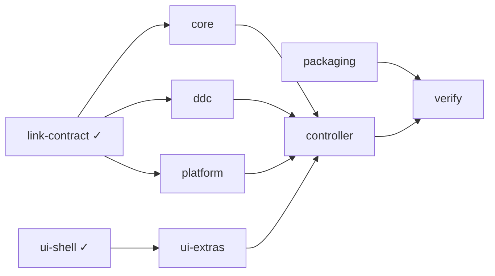

# Rust + Slint port with the compact window (0.0.5 phase 1)

Design: [2026-10-28-rust-slint-design.md](../specs/2026-10-28-rust-slint-design.md). Parity checklist: [2026-10-28-parity-inventory.md](../specs/2026-10-28-parity-inventory.md) (cited below as **INV §n**).

## Goal

- One Rust code base, three crates, building on Windows; Linux and macOS compile-checked (`cargo check --target`).
- Every INV item works in the Rust build except §11 (power), which is absent by design.
- The compact tabbed window (screenshots in `docs/previews/slint/`).
- Release exe ≤ 10 MB on Windows.

## Target files

- [Cargo.toml](../../../Cargo.toml) — workspace; release profile. **Agents add dependencies in their own crate's `Cargo.toml`, never in the workspace file.**
- `crates/tvc-core/` — owned by `core`, except [src/link.rs](../../../crates/tvc-core/src/link.rs) (pinned, below).
- `crates/tvc-ddc/` — owned by `ddc`.
- `crates/tvc-app/src/platform/` — owned by `platform`, plus one line `mod platform;` in `src/main.rs`.
- `crates/tvc-app/ui/` — owned by `ui-extras` (except `ui/fonts/`, owned by `packaging`).
- `crates/tvc-app/src/{main,controller,bridge,tray,osd,demo}.rs` — `controller`.
- `packaging/`, `scripts/` — owned by `packaging`.

## Pinned contracts

### MonitorLink (done)

[crates/tvc-core/src/link.rs](../../../crates/tvc-core/src/link.rs): `MonitorMatch { edid_id, description_hint }`, `LinkFailure { NotFound, PermissionDenied, ModuleMissing, UnsupportedPort }`, `LinkError { Transient, Unsupported, Gone }`, `VcpReading { current: u16, max: u16 }`, trait `MonitorLink: Send { connect, disconnect, capabilities, read, write }`. Values are `u16` (DDC is 16-bit).

### tvc-ddc entry point

```rust
pub fn open(target: MonitorMatch) -> Box<dyn MonitorLink>;   // per-OS backend; never fails, connect() reports
pub mod packet;   // DdcPacket port (INV §8.9), pub for tests
pub mod edid;     // EDID match (INV §9.2)
```

### tvc-core engine (consumed by `controller`)

```rust
pub struct Engine;   // Engine::spawn(link, profile_store, data: DataDir, timing, sink) -> EngineHandle
pub struct EngineHandle;   // send(Command); shutdown() waits ≤ 1 s
pub enum Command { Connect, RecheckAfterEvent, RequestReconnect, Refresh(Vec<u8>), Poll(Vec<u8>),
    Set { code: u8, value: u16, confirmed: bool, origin: Origin }, DragTo { code: u8, value: u16 },
    EndDrag { code: u8, value: u16, origin: Origin }, Step { code: u8, delta: i32, origin: Origin },
    ApplyPreset { preset: Preset, origin: Origin }, RestoreBackup { origin: Origin },
    FinderSnapshot, FinderCompare, SaveOverlay(ControlDefinition), Shutdown }
pub enum Origin { Window, Hotkey, Tray, Cli }   // controller decides OSD vs note vs toast by origin
pub enum Event { Status { status: MonitorStatus, failure: Option<LinkFailure> },
    Controls(Arc<ResolvedControls>), Value { code: u8, reading: VcpReading },
    Result { origin: Origin, code: Option<u8>, result: WriteResult },
    Finder(FinderEvent) }
```

- `sink: Box<dyn Fn(Event) + Send>`; the app wraps `slint::invoke_from_event_loop`.
- `WriteResult { outcome: Ok|NeedsConfirmation|Blocked|NotResponding, message, value: Option<u16>, kept: Option<u16> }`. `kept` carries "the monitor kept X" so the UI need not parse messages (INV §1.3 note).
- Semantics = INV §8.3, §8.4, §7 (retry burst 0.5/1/2/4/8 s; poll skips during drag and within 1 s of a write and never marks lost; refresh can). `RecheckAfterEvent` = reconnect even while connected, then burst if still not connected.
- Capabilities read once per process; cached to `capabilities.txt` (INV §5.2).

### Profile v2 (embedded `p32p20.json`, owned by `core`)

Adds to 0.0.4's schema (which must still load for `profile.user.json` overlays): `displayName`, `shortName` ("P32p-20"), `inputs: [{code, label, kind}]` in display order, `colourModeOrder`, `brightnessLockNote`, `customColourMode` (0x12), per-control `group` (`picture|ports|osd|reset`), `description`, `icon` (glyph name from `theme.slint` Glyphs), `confirmTitle`/`confirmBody`/`confirmButton`, and `quirks.timing` (`gapMs 50, settleMs 400, retryMs 150, attempts 5`). 0xD6 is `NeverWrite` and excluded from the finder; 0xCA stays `NeverWrite`.

### Data directory and files

`platform::data_dir()` = `%APPDATA%\ThinkVisionControl` / `$XDG_CONFIG_HOME|~/.config/ThinkVisionControl` (INV §5) — same folder as 0.0.4, so settings carry over. Files keep their 0.0.4 names and formats (INV §5.1–5.2): `settings.json` (PascalCase, `"0xNN"` bytes, migrations), `profile.user.json`, `capabilities.txt`, `backup-*.json`, `log.txt`. Per-monitor subfolders (E3) are deferred: moving files would break a 0.0.4 → 0.0.5 → 0.0.4 downgrade for no phase-1 gain. **Changed from the design doc; my call.**

### Platform (consumed by `controller`)

```rust
pub fn data_dir() -> PathBuf;
pub mod instance { pub enum Start { Primary(Listener), Forwarded } pub fn start(args: &[String]) -> Start;
                   impl Listener { pub fn listen(self, on_args: impl Fn(Vec<String>) + Send + 'static); } }
pub mod autostart { pub fn apply(enabled: bool) -> io::Result<()>; pub fn label() -> &'static str; }
pub mod monitor_events { pub fn watch(on_change: impl Fn() + Send + 'static) -> Watcher; }  // debounced per INV §7
pub mod efficiency { pub fn set_window_visible(visible: bool); }                           // no-op off Windows
pub mod taskbar { pub fn is_light() -> bool; }                                              // tray icon variant
pub mod setup { pub struct Hint { id, title, message, command }; pub fn hints(failure: Option<LinkFailure>, hotkeys_ok: bool) -> Vec<Hint>; }
pub mod hotkeys { pub struct Hotkeys; fn new(on_press: impl Fn(Action) + Send + 'static) -> Option<Self>;
                  fn register(&mut self, map: &[(Action, Gesture)]) -> Vec<Action /* failed */>; fn suspend(&mut self); }
```

Names that must not change (INV §10): mutex `ThinkVisionControl.SingleInstance`, pipe `ThinkVisionControl.Commands.{user}.{session}`, Run value `ThinkVisionControl` = `"<exe>" --startup`. `hotkeys` takes `Action`/`Gesture` from tvc-core; until `core` lands, `platform` defines a local `Gesture { mods: u8 /* Win32 MOD bits */, vk: u16 }` and `Action = usize`, which `controller` maps.

## Implementation steps

1. **core** — Port `src/ThinkVisionControl.Core` into modules `mccs`, `profile`, `safety`, `engine`, `store`, `hotkey`, `cli`, `finder`, `log`, plus `fake` (feature `fake`, also on in `cfg(test)`). Engine = one thread owning link + cache + drags + status; `recv_timeout` deadlines for burst and settle. Port every test listed in INV §13 that targets core, with zero timings. Dependencies allowed: `serde`, `serde_json`. `#![forbid(unsafe_code)]` stays.
2. **ddc** — Port `src/ThinkVisionControl.Ddc.{Windows,Linux,MacOS}` and `Mccs/DdcPacket.cs` per INV §9 and §8.9. Windows via `windows-sys`; Linux via `libc` ioctl/flock; macOS via raw `extern "C"` to IOKit/CoreDisplay/CoreGraphics (dlopen'd where 0.0.4 does). Port the packet/EDID/bus-order/mac-rules tests. Check with `cargo check --target x86_64-unknown-linux-gnu` and `--target aarch64-apple-darwin` (`rustup target add`).
3. **platform** — Port per INV §6, §7, §9 setup hints, §3.3 (global-hotkey crate for Windows/X11/macOS; Wayland portal = follow-up, see Open questions). Windows via `windows-sys`.
4. **packaging** — `packaging/windows/ThinkVisionControl.iss`: drop the .NET task, ship `thinkvision-control.exe` (+ license), keep AppId, AppMutex, Run-value cleanup; `scripts/make-windows-setup.ps1` builds with cargo. New `scripts/make-linux-tarball.sh`, update `scripts/make-macos-app.sh` (version from Cargo.toml). Subset `crates/tvc-app/ui/fonts/FluentSystemIcons-Regular.ttf` to the glyphs used in `ui/*.slint` + a `scripts/subset-icon-font.py` to regenerate it; keep the font's MIT licence file next to it.
5. **ui-extras** — Finder as a sub-page of the Monitor tab (back arrow, steps 1–3, naming form) per INV §1.7; shortcut editor as an in-window dialog with key capture per INV §3.4; "Restore backup" row in Reset and restore; preset save feedback (INV §4). Extend `App` global; keep the demo wiring compiling.
6. **controller** — Wire it all: CLI → headless/resident (INV §6.2), engine sink → `AppState` → bridge (only while visible), confirms (INV §1.8, Cancel default), notes/toasts/OSD by origin, tray (INV §2; menu = Avalonia's, incl. Switch to this PC), hotkeys, settings save → re-apply, drop window on close, OSD kept with alpha toggle, 3 s poll while visible, monitor events → `RecheckAfterEvent`. `--demo` runs on `FakeLink`.



## Key design decisions

- **Engine owns state on one thread** instead of C#'s lock + async: no shared mutable state with the UI, deterministic tests with zero timings.
- **Drag coalescing by draining the channel** before each write (keeps newest `DragTo` per code).
- **Origin on every command** so the controller can route feedback: window → card note/toast; hotkey/tray/CLI → OSD (INV §1.6).
- **Input confirmation stays window-only** (INV §1.8) — parity; A3 may revisit.
- **Tray menu = Avalonia's** (adds Switch to this PC on Windows too). Small, deliberate parity break toward the better behaviour.
- **No restart-on-close**: the window component is dropped instead (background NOTES).
- **Finder and shortcut editor live inside the main window** (sub-page / dialog) instead of extra OS windows: fewer Slint windows to manage under the hidden-window rules.
- **Data folder unchanged** (see Data directory).

## Verification

- `cargo test --workspace` — core and ddc unit tests green.
- `cargo clippy --workspace --all-targets -- -D warnings`.
- `cargo check -p tvc-ddc --target x86_64-unknown-linux-gnu` and `--target aarch64-apple-darwin`.
- `cargo build --release`; `target/release/thinkvision-control.exe` ≤ 10 MB.
- Run `thinkvision-control --demo` and capture all tabs (dark/light) with `crates/tvc-app/tools/capture.ps1`.
- On the real monitor (owner): brightness drag, input switch confirm, preset, hotkeys + OSD, tray menu, close → tray memory ≈ 3 MB.
- Walk INV §1–§10 and tick each item in a parity table appended to this plan.

## Open questions

- **Wayland global shortcuts** (INV §3.3): needs xdg-desktop-portal GlobalShortcuts over D-Bus (`zbus`), size cost unknown. Planned as a follow-up inside phase 1; X11/XWayland works via `global-hotkey`.
- **Wayland OSD as notifications** (INV §9.2): same D-Bus dependency; same follow-up.
- **macOS**: compile-checked only; no hardware.
- **Jump list / .desktop actions** (INV §12): Windows jump list deferred unless cheap; Linux .desktop actions come with the packaging.

## Deviations from this plan

Decided during implementation; recorded here so the design doc and this plan read correctly against the code.

- **Shortcuts keep 0.0.4's three fixed input actions** (`InputHdmi`/`InputDp`/`InputUsbC`) instead of one data-driven "switch to input" action; E4 is deferred. The controller resolves each through the profile's input `kind`.
- **The overlay can never override a `NeverWrite` code** (`0xCA`, `0xD6`): `save_overlay` refuses. This closes the `0xD6` hazard (INV §11) on every path, including the finder.
- **`WhenQuiet` not ported.** It only served WPF's restart-on-close, which is gone: the window is dropped instead.
- **Wayland:** `Hotkeys::new` returns `None` on Wayland sessions (XWayland grabs only fire while an X11 window has focus), so the `linux-hotkeys` setup hint shows instead. Portal shortcuts and the notification OSD remain a follow-up.
- **macOS autostart** uses `SMAppService` through `objc_msgSend`; no LaunchAgent fallback is needed.
- **Finder and shortcut editor are in-window** (sub-page of the Monitor tab / dialog), not separate OS windows.
- **Copy buttons** use the Win32 clipboard on Windows and `pbcopy` / `wl-copy` / `xclip` / `xsel` elsewhere.
- **Release exe 8.73 MB** (Windows), after subsetting the icon font from 2.8 MB to 7 KB (`scripts/subset-icon-font.py`).
- **Backup and log timestamps** use the local UTC offset passed in from the app (`clock::set_utc_offset`), since `tvc-core` makes no OS calls.

## Hardware test checklist (deferred)

Run with the P32p-20 attached (owner). Tick each and note anything that differs from 0.0.4.

- [ ] Brightness drag; the "kept old value" note in sRGB, DCI-P3 and BT.709.
- [ ] Input switch: the confirm, and switching from the PC the monitor isn't showing.
- [ ] Presets: apply Day and Night; save current.
- [ ] Every hotkey, with the OSD.
- [ ] Tray menu, and badge states: unplug → ×, DDC/CI off → !.
- [ ] Close → tray: memory ≈ 3 MB and about 0 idle CPU.
- [ ] Upgrade install over 0.0.4: settings carried over, old .NET files removed.
- [ ] Autostart: the Run key value, and a start at sign-in.
- [ ] Finder: snapshot, compare, name a code.
- [ ] Factory reset, then Restore backup.
- [ ] Linux on real hardware, including the i2c permission hints.
- [ ] macOS, when a Mac is available.
