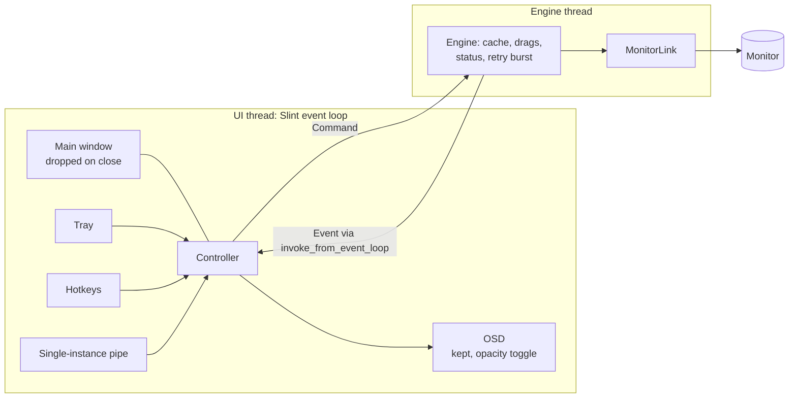

# ThinkVision Control 0.0.5: new look, new stack (Rust + Slint)

Date: 2026-10-28. Status: draft, owner skipped the question round, so every call below is mine unless marked **owner**.

Sources:
- Stack decision and measurements: [2026-10-28-lightweight-ui.md](../../research/2026-10-28-lightweight-ui.md), [2026-10-28-ui-look-comparison.md](../../research/2026-10-28-ui-look-comparison.md), background-mode rules in [lightweight-ui-probes/background/NOTES.md](../../research/lightweight-ui-probes/background/NOTES.md).
- What to build next and what to leave out: [2026-10-28-open-source-learnings.md](../../research/2026-10-28-open-source-learnings.md) (Recommendation, Phase 1).
- Everything 0.0.4 does: [2026-10-28-parity-inventory.md](2026-10-28-parity-inventory.md).

## Intent

0.0.5 phase 1 rebuilds the app in Rust + Slint so it ships under 10 MB, starts in about 0.1 s and idles at a few MB in the tray, on every OS from one code base. Two UI stacks (WPF + Avalonia) become one.

While the UI is rebuilt anyway, fix the layout: the 320 px navigation pane holds three links and wastes about a third of the window (**owner**: "the left nav bar takes almost 40% of screen and only has 3 options").

## Goals

- Parity with 0.0.4 on Windows and Linux, minus power control (G). macOS builds and runs; hardware testing there stays open, as today.
- A compact window that works as the everyday quick panel (since 0.0.4 a tray click opens it).
- An architecture where E1–E5 (model-neutral profiles) slot in without rework: no P32p-20 values in UI or app code.
- Phase 2 (A1–A4, C1, C3) and phase 3 (B1, B5) land as additions, not rewrites.

## Non-goals

- New features beyond the redesign. Phase 2/3 items are planned separately.
- Several monitors at once (E7). Code is keyed by monitor so it stays possible.
- Mica, custom title bar, page animations (software renderer; see the look comparison).

## Anti-goals

- Memory or CPU creep in the tray: no polling while hidden, no hidden Slint windows holding a surface.
- A port that silently drops 0.0.4 behaviour. The parity inventory is the checklist.
- Writing to `0xD6` (power) from any path.

## UX: one compact window

### Why

Usage splits into three frequencies:

| How often | What |
|---|---|
| Every day | Input switch (two-PC desk), brightness, contrast, Day/Night |
| Sometimes | Colour mode, custom RGB |
| Rarely | Over Drive, Dynamic Contrast, aspect, USB charging, OSD language, resets, hidden-settings finder, app settings, shortcuts |

The old layout gave every frequency the same weight and spent 320 px of width on navigation. The new one puts the daily controls on one screen with no scrolling, and moves navigation into a 40 px tab strip.

### Layout

Default window 560 × 680, minimum 440 × 520, resizable. Content column max 720 px, centred when wider.

```
┌───────────────────────────────────────────────────────┐
│ [monitor]  ThinkVision P32p-20                         │  header
│            ✓ Connected over HDMI · Firmware LB1.2      │
│  Display    Monitor    Settings                        │  tab strip, accent underline
│  ───────                                               │
├───────────────────────────────────────────────────────┤
│ (state banner when not connected / not answering)      │
│                                                        │
│ Input                                                  │
│ ┌──────────────┐┌──────────────┐┌──────────────┐       │  segmented, 3 equal buttons
│ │ HDMI         ││ DisplayPort  ││ USB-C        │       │  "This PC" caption on ours
│ │ This PC      ││              ││              │       │
│ └──────────────┘└──────────────┘└──────────────┘       │
│                                                        │
│ ☀  Brightness   ─────●──────────────────   40          │  one card, two rows
│ ◐  Contrast     ───────────●────────────   70          │
│                                                        │
│ Presets          [ ☀ Day ]  [ ☾ Night ]                │
│                                                        │
│ Colour mode                       [ Neutral        ▾ ] │
│ ▸ Custom colour  (R/G/B; only in User / Custom)        │
└───────────────────────────────────────────────────────┘
```

- **Display tab** (default): input, brightness and contrast, presets, colour mode, custom colour. Fits 680 px tall without scrolling with custom colour collapsed.
- **Monitor tab**: the profile's other controls, grouped as the profile says (Picture, Ports, On-screen menu), then Reset and restore, then "Find hidden settings". Rendered generically from the profile, so a code named in the finder appears here with no code change. The finder opens as a sub-page of this tab (back arrow), not a separate window; the shortcut editor and confirms are in-window dialogs. Fewer OS windows means fewer Slint windows to keep within the hidden-window rules.

Screenshots of the built layout (demo data): [docs/previews/slint/](../../previews/slint/).
- **Settings tab**: system setup hints (Linux/macOS, only when something is missing), Startup (run in background, start with OS), This PC's input, Keyboard shortcuts, Presets (save current as Day/Night), About.
- **Header** shows the model name from the profile and the connection line. States (not connected, not answering, setup needed) show as one banner under the tabs on every tab, not per page.
- **Narrow windows** (< 520 px): input buttons drop the "This PC" second line into the tooltip; sliders keep full width.
- **Keyboard**: Ctrl+1/2/3 switch tabs; Tab order header → tabs → content. All controls keep Slint's accessibility roles.

### Why tabs, not an icon rail or a two-column dashboard

- An icon rail (48 px) keeps a Windows-Settings feel but still costs width for three items and hides labels.
- A wide two-column dashboard fits everything without tabs, but the window then opens at about 900 px wide from a tray click; too big for a quick panel.
- Tabs cost 40 px of height, keep labels, and leave the Display tab as the quick panel.

### Visual language (unchanged from the look-alike)

Fluent tokens from the Slint look-alike (`theme.slint`): neutral window / layer / card colours, Segoe UI Variable, Fluent System Icons font, cards with 4 px gaps, system accent through Slint's palette. Exact-accent controls stay out of scope (see the look comparison).

### OSD and tray

- OSD: unchanged look (264 × 64 card, bottom centre of the work area, 1.5 s). Kept alive, shown and hidden by opacity (background-mode rules).
- Tray menu unchanged from 0.0.4: Open, Day, Night, Switch to this PC, Exit (Linux keeps its brightness items). Left click opens or focuses the window.

## Architecture

### Workspace

A Cargo workspace at the repo root, next to the C# solution. The C# code stays until the Rust build reaches parity, then is removed in its own change.

```
Cargo.toml                 workspace, shared release profile (opt-level "z", lto, strip, panic=abort)
crates/
  tvc-core/                pure logic: no OS calls, no UI, #![forbid(unsafe_code)]; all unit tests live here
  tvc-ddc/                 MonitorLink backends: windows (dxva2), linux (i2c-dev), macos (IOAVService), fake
  tvc-app/                 the `thinkvision-control` binary: Slint UI, controller, tray, hotkeys, OSD, OS glue
    ui/                    .slint files
    src/platform/{windows,linux,macos}.rs
```

Three crates, not more: the core must build and test without a display or a monitor; the backends are the only `unsafe` FFI to hardware; everything that needs Slint or OS integration is one binary.



### tvc-core

| Module | Responsibility | From (C#) |
|---|---|---|
| `mccs` | DDC packet build/parse, capability-string parser, standard VCP names (fallback labels) | `Mccs/DdcPacket`, `Profile/CapabilitiesParser` |
| `profile` | Profile model, embedded `p32p20.json`, user overlay, resolve against capabilities | `Profile/*` |
| `safety` | Pure write rules | `Control/SafetyPolicy` |
| `link` | `MonitorLink` trait, `LinkError`, `LinkFailure`, `VcpReading` | `Ddc/IMonitorLink`, `LinkFailure` |
| `engine` | One worker thread that owns the link and all monitor state; takes `Command`s, emits `Event`s | `Ddc/DdcQueue` + `Control/ControlService` + `RetryBurst` |
| `store` | Settings (+ migration from the 0.0.4 file), capabilities cache, backups, all under a per-monitor data folder | `Settings/*`, `Control/BackupStore`, `CapabilitiesCache` |
| `hotkey` | Gesture parse/format, action list | `Settings/HotkeyGesture` |
| `cli` | Argument parsing into `Command`s | `Commands/CommandLine` |
| `finder` | Hidden-settings scan | `Finder/VendorCodeFinder` |
| `log` | Size-capped file log | `Logging/FileLog` |

**Engine: one owner, no locks.** C# guards a value cache, drag state and status with a lock across async tasks. The Rust engine is a plain thread that owns all of it; the UI never touches monitor state directly.

- `Engine::spawn(link, profile, stores, sink) -> EngineHandle`; `EngineHandle::send(Command)`.
- `Command`: `Connect`, `RequestReconnect`, `Refresh(codes)`, `Poll(codes)`, `Set { code, value, confirmed, origin }`, `DragTo { code, value }`, `EndDrag { code, value }`, `Step { code, delta, origin }`, `ApplyPreset`, `RestoreBackup`, `ReloadProfile`, `FinderScan`, `Shutdown`.
- `Event`: `Status { status, failure }`, `Value { code, reading }`, `Controls(resolved profile)`, `Result { origin, outcome, message, value }`, finder progress.
- **Drag coalescing:** before each write the engine drains the channel and keeps only the newest `DragTo` per code. That gives C#'s "latest value wins, one write in flight" without a drag loop.
- **Timing** (50 ms gap, 400 ms settle before a read after a write, 150 ms retry gap, 5 attempts, retry burst delays) comes from a `Timing` value in the profile's quirks block, defaulting to today's constants. Tests use zero timings.
- **Retry burst and 3 s poll** are deadlines inside the engine loop (`recv_timeout`), not separate timers. The UI asks for polling with `Poll` only while the window is visible.
- `LinkError` already has the three classes A2 needs (`Transient`, `Unsupported`, `Gone`). In phase 1 every error is retried as today; phase 2 changes only the engine's retry rule.

**Profile, ready for E1–E5.** The profile JSON gains what today lives in view models: `displayName`, per-control `group` (Picture / Ports / On-screen menu), `label`, `description`, `icon`, value order, the input list with kinds (`hdmi`, `dp`, `usbc`), `brightnessLockedBy` (colour modes that lock brightness), and a `quirks` block (`timing`). The UI renders the Monitor tab and the input buttons from it. `0xD6` is `NeverWrite` (G). No P32p-20 code or name appears in `tvc-app`.

**Data folder unchanged from 0.0.4** (`%APPDATA%\ThinkVisionControl`, `~/.config/ThinkVisionControl`), same file names and formats, so settings carry over and a downgrade still works. Per-monitor subfolders (E3) wait for E3 itself; the store takes the folder as a parameter, so moving it later touches one place.

**Shortcuts (E4 shape):** `InputHdmi/InputDp/InputUsbC` become one `SwitchInput(code)` action internally. The 0.0.4 file's keys are read and mapped, and written back in the new form.

### tvc-ddc

One crate, one module per OS behind `cfg`, plus `fake` (used by tests and `--demo`). Each implements `MonitorLink`:

```rust
pub trait MonitorLink: Send {
    fn connect(&mut self) -> Result<MonitorInfo, LinkFailure>;   // finds the monitor by EDID id
    fn capabilities(&mut self) -> Result<String, LinkError>;
    fn read(&mut self, code: u8) -> Result<VcpReading, LinkError>;
    fn write(&mut self, code: u8, value: u16) -> Result<(), LinkError>;
}
```

Ports of `Dxva2MonitorLink`, `I2cMonitorLink` (+ `I2cBusLocator`, `Edid`) and `IoAvMonitorLink` (+ `AvServiceLocator`, `MacDdcRules`). The EDID id to look for is a parameter (E6 shape).

### tvc-app

| Module | Responsibility |
|---|---|
| `main.rs` | Parse CLI; single-instance hand-off; build engine, tray, hotkeys; run the event loop until quit |
| `controller.rs` | UI-thread state (`Rc<RefCell<AppState>>`): latest values, status, settings. Turns UI/tray/hotkey actions into `Command`s, `Event`s into UI updates, OSD shows and toasts |
| `ui_bridge.rs` | Copies `AppState` into the main window on open and on change while visible; wires window callbacks |
| `tray.rs`, `hotkeys.rs`, `osd.rs` | As proven in the background probe |
| `platform/*` | Autostart, single-instance + command forwarding, display/resume events, theme, efficiency mode (Windows), Linux setup hints and udev install, macOS window tweaks |

Background-mode rules (from the probe, binding):
- The main window component is **dropped** on close and rebuilt on open (about 3 MB in the tray against 5.8 MB hidden). This replaces WPF's restart-on-close.
- Never set properties on a hidden Slint window, and never hide a Slint window through Win32. The bridge pushes state only while the window is visible and on open.
- The OSD window is created once and stays "visible", toggled by layered alpha.
- Hotkeys use `global-hotkey`, delivered through `invoke_from_event_loop`; no polling timer.

### Size

The look-alike exe was 10.4 MB with `accessibility`, the embedded icon font and `fluent` style. Trimming levers, in order: subset the icon font to the glyphs used (the full TTF is about 2.8 MB, under 50 glyphs are used), drop unused Slint features, `opt-level = "z"` + LTO already on. Accessibility stays.

## Delivery order

1. Workspace + `tvc-core` (profile, safety, mccs, engine with fake link, store, cli, hotkey) with unit tests ported from `tests/`.
2. In parallel: `tvc-ddc` Windows + Linux + macOS backends; the new Slint UI with demo data (fake link).
3. `tvc-app` wiring: controller, tray, hotkeys, OSD, single instance, autostart, display events.
4. Parity pass against the inventory; size trim; installer and Linux packaging switched to the Rust binary.
5. Remove the C# projects (separate change).

## Left to the builder

- Exact card heights, paddings and glyph choices within the Fluent tokens above.
- Module file splits inside each crate.
- Which crate provides single-instance IPC (named pipe / unix socket by hand, or a small crate), as long as the binary stays under budget.

## Open questions

- macOS: can only be built and smoke-tested off-machine; same status as 0.0.4.
- Linux Wayland: global hotkeys go through the XDG portal in 0.0.4; the Rust port needs the same (via `ashpd`/zbus or hand-rolled D-Bus). Size impact unknown.
